# When Better Denoising Does Not Mean Better Speaker Verification

## An Empirical Study of Speech Enhancement and Speaker Identity Preservation

Chenxin Zhang

# 1. Research question, data split and settings

This experiment examines whether gains in SI-SDR and STOI after denoising accompany lower speaker-verification error rates, how subtraction strength affects this relationship, and how results vary across noise categories and sources.

```matlab
clearvars; format shortG;
projectRoot=local_project_root(mfilename('fullpath'));
% Supporting MATLAB functions are defined at the end of this Live Script.
ctx=local_context(projectRoot,"en");
fs=ctx.parameters.sample_rate; cfg=ctx.parameters.cfg;
rng(ctx.parameters.seed,'twister');
conditions=readtable(fullfile(projectRoot,'protocol','A','noise_audit','candidate_snr_conditions.csv'), ...
 'Delimiter',',','ReadVariableNames',true,'TextType','string','VariableNamingRule','preserve');
utterances=readtable(fullfile(projectRoot,'protocol','A','material_audit','candidate_utterance_roles_cropped.csv'), ...
 'Delimiter',',','ReadVariableNames',true,'TextType','string','VariableNamingRule','preserve');
labels=["Primary enrollment reference";"Alternative enrollment reference";"Development: enrolled speakers"; ...
 "Development: unenrolled speakers";"Test: enrolled speakers";"Test: unenrolled speakers"];
recordingRoles=["enrollment_primary","enrollment_backup","development","development","test","test"];
speakerCount=zeros(6,1);recordingCount=zeros(6,1);mixtureCount=zeros(6,1);
for j=1:6
 mask=utterances.RecordingRole==recordingRoles(j);
 if j>2
  if ismember(j,[3 5]),mask=mask & utterances.ParticipantRole=="target";
  else,mask=mask & utterances.ParticipantRole~="target";end
 end
 speakerCount(j)=numel(unique(utterances.SpeakerID(mask)));recordingCount(j)=sum(mask);
 if j>2
  split="development";if j>=5,split="test";end
  cmask=conditions.Split==split;
  if ismember(j,[3 5]),cmask=cmask & conditions.ParticipantRole=="target";
  else,cmask=cmask & conditions.ParticipantRole~="target";end
  mixtureCount(j)=sum(cmask);
 end
end
dataSplit=table(labels,speakerCount,recordingCount,mixtureCount, ...
 'VariableNames',{'Purpose','Speakers','Source_recordings','Planned_mixtures'});disp(dataSplit);
```

```matlabTextOutput
                 Purpose                  Speakers    Source_recordings    Planned_mixtures
    __________________________________    ________    _________________    ________________

    "Primary enrollment reference"           20              20                    0
    "Alternative enrollment reference"       20              20                    0
    "Development: enrolled speakers"         20              40                  480
    "Development: unenrolled speakers"        6              12                  144
    "Test: enrolled speakers"                20              60                  720
    "Test: unenrolled speakers"              10              30                  360
```

```matlab
settings=table(["Sample rate";"Window length";"Hop size";"FFT length";"Noise-selection percentile";"Example alpha";"Power floor beta"], ...
 [fs;cfg.winLength;cfg.hopSize;cfg.nfft;cfg.noisePercentile;cfg.alpha;cfg.beta], ...
 'VariableNames',{'Parameter','Value'});disp(settings);
```

```matlabTextOutput
             Parameter              Value
    ____________________________    _____

    "Sample rate"                   16000
    "Window length"                   512
    "Hop size"                        128
    "FFT length"                     1024
    "Noise-selection percentile"       20
    "Example alpha"                   1.5
    "Power floor beta"               0.02
```

Tables 1 and 2: Speech-data split and processing settings. Sample rate is in Hz; window and hop lengths are in samples. Enrollment recordings provide identity references. Unenrolled speakers are used to test whether the system incorrectly accepts an outside speaker.

# 2. Select and read clean speech

Read a five-second clean utterance and add noise to form a 5 dB example for demonstrating STFT analysis, spectral subtraction and reconstruction.

```matlab
assert(exist('ctx','var')==1,'Run Section 1 first.');
candidates=conditions(conditions.Split=="test" & conditions.ParticipantRole=="target" & conditions.InputSNR_dB==5,:);
candidates=sortrows(candidates,'ConditionID');sample=candidates(1,:);
disp(sample(:,{'ConditionID','UtteranceID','NoiseClass','NoiseSourceID','InputSNR_dB'}));
```

```matlabTextOutput
         ConditionID            UtteranceID      NoiseClass     NoiseSourceID     InputSNR_dB
    ______________________    _______________    __________    _______________    ___________

    "test_base_0157_snr_5"    "61-70968-0015"     "Babble"     "BABBLE_test_1"         5
```

```matlab
rawPath=local_original_speech(ctx,sample);
[originalSpeech,speechRate]=audioread(rawPath);
assert(speechRate==fs && size(originalSpeech,2)==1);
originalSpeech=originalSpeech-mean(originalSpeech);
firstSample=sample.SpeechStartSample+1; N=sample.Samples;
assert(firstSample+N-1<=numel(originalSpeech));
clean=originalSpeech(firstSample:firstSample+N-1);
clean=clean-mean(clean);
clean=ctx.parameters.clean_peak*clean/max(abs(clean));
% Match the precision of subsequent FLOAT audio exports.
clean=double(single(clean));
time=(0:N-1)'/fs;
figure('Color','w');plot(time,clean);xlabel('Time / s');ylabel('Amplitude');title('Clean speech');grid on;
```

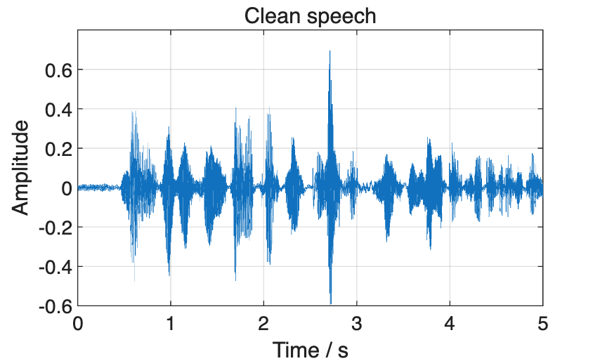

```matlab
speechInfo=table(speechRate,N,N/fs,max(abs(clean)), ...
 'VariableNames',{'Sample_rate_Hz','Samples','Duration_s','Peak_amplitude'});disp(speechInfo);
```

```matlabTextOutput
    Sample_rate_Hz    Samples    Duration_s    Peak_amplitude
    ______________    _______    __________    ______________

        16000          80000         5              0.7
```

Figure 1 and Tables 3 and 4: The example utterance, duration, sample rate and peak amplitude. The same clean utterance is the reference throughout the example.

# 3. Read a noise segment

Read a five-second noise segment and remove its mean. Babble contains four background speakers. LowVariation and HighVariation are the groups with relatively smaller and larger energy fluctuations among the noise materials used here.

```matlab
assert(exist('clean','var')==1,'Run Section 2 first.');
noisePath=local_noise_path(ctx,sample.NoiseClass,sample.NoiseSourceID);
[noiseSource,noiseRate]=audioread(noisePath);
assert(noiseRate==fs && size(noiseSource,2)==1);
noiseIndices=sample.NoiseStartSample+(1:N);
assert(noiseIndices(end)<=numel(noiseSource));
noise=noiseSource(noiseIndices);noise=noise-mean(noise);
assert(numel(noise)==numel(clean) && sum(noise.^2)>0);
figure('Color','w');plot(time,noise);xlabel('Time / s');ylabel('Amplitude');title('Unscaled noise segment');grid on;
```

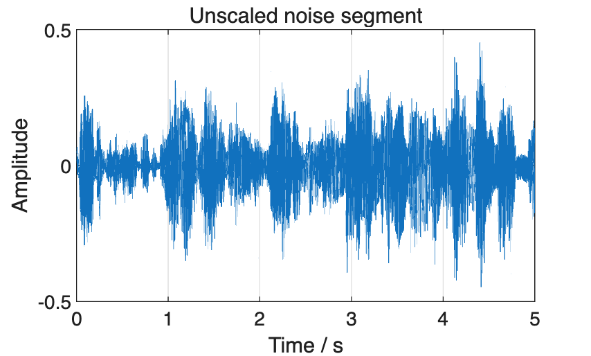

```matlab
noiseInfo=table(sample.NoiseClass,sample.NoiseSourceID,sample.NoiseStartSample,N/fs, ...
 'VariableNames',{'Noise_category','Noise_source','Start_sample_zero_based','Duration_s'});disp(noiseInfo);
```

```matlabTextOutput
    Noise_category     Noise_source      Start_sample_zero_based    Duration_s
    ______________    _______________    _______________________    __________

       "Babble"       "BABBLE_test_1"          3.2524e+06               5
```

Figure 2 and Table 5: The example noise segment and its position in the source recording. The manifest uses zero-based sample offsets; the code converts these to MATLAB's one-based indexing.

# 4. Generate a mixture at the specified SNR

SNR is the energy ratio over the complete five-second clean utterance and added noise: SNR = 10 log10(Σx²/Σd²). Scale the selected noise segment v by k, then form d = kv and y = x + d.

```matlab
assert(exist('noise','var')==1,'Run Section 3 first.');
targetSNR=sample.InputSNR_dB;
noiseScale=sqrt(sum(clean.^2)/(sum(noise.^2)*10^(targetSNR/10)));
noiseComponent=double(single(noiseScale*noise));
noisy=clean+noiseComponent;
measuredSNR=10*log10(sum(clean.^2)/sum(noiseComponent.^2));
snrInfo=table(targetSNR,noiseScale,measuredSNR,measuredSNR-targetSNR, ...
 'VariableNames',{'Target_SNR_dB','Noise_scale','Measured_SNR_dB','Error_dB'});disp(snrInfo);
```

```matlabTextOutput
    Target_SNR_dB    Noise_scale    Measured_SNR_dB     Error_dB
    _____________    ___________    _______________    ___________

          5            0.41618             5           -9.7073e-10
```

```matlab
figure('Color','w');tiledlayout(3,1,'TileSpacing','compact');
nexttile;plot(time,clean);ylabel('Amplitude');title('Clean speech');grid on;
nexttile;plot(time,noiseComponent);ylabel('Amplitude');title('Scaled noise');grid on;
nexttile;plot(time,noisy);xlabel('Time / s');ylabel('Amplitude');title('Noisy speech');grid on;
```

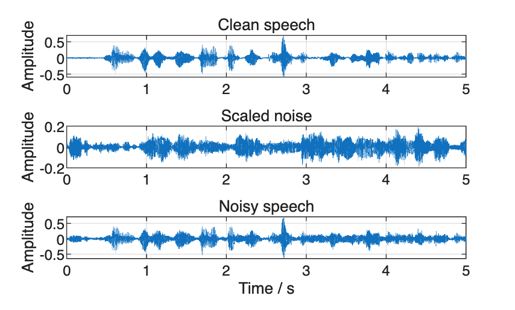

Table 6 and Figure 3: Clean speech, added noise and noisy speech. The measured SNR is close to the specified 5 dB.

# 5. Generate four SNR levels using the same segments

Use the same clean utterance and noise segment, changing only noise amplitude to generate mixtures at −5, 0, 5 and 10 dB.

```matlab
assert(exist('noisy','var')==1,'Run Section 4 first.');
snrLevels=ctx.parameters.input_snr_db(:);scales=zeros(size(snrLevels));actualSNR=scales;
for j=1:numel(snrLevels)
 scales(j)=sqrt(sum(clean.^2)/(sum(noise.^2)*10^(snrLevels(j)/10)));
 component=double(single(scales(j)*noise));
 actualSNR(j)=10*log10(sum(clean.^2)/sum(component.^2));
end
snrCheck=table(snrLevels,scales,actualSNR,actualSNR-snrLevels, ...
 'VariableNames',{'Target_SNR_dB','Noise_scale','Measured_SNR_dB','Error_dB'});disp(snrCheck);
```

```matlabTextOutput
    Target_SNR_dB    Noise_scale    Measured_SNR_dB     Error_dB
    _____________    ___________    _______________    ___________

         -5             1.3161                -5       -1.1855e-09
          0            0.74009        3.6451e-09        3.6451e-09
          5            0.41618                 5       -9.7073e-10
         10            0.23404                10        1.6437e-09
```

```matlab
maximumSNRError=max(abs(actualSNR-snrLevels));
disp(table(maximumSNRError,'VariableNames',{'Maximum_SNR_error_dB'}));
```

```matlabTextOutput
    Maximum_SNR_error_dB
    ____________________

         3.6451e-09
```

```matlab
assert(maximumSNRError<1e-6,'SNR mixing check failed.');
```

Tables 7 and 8: Noise scaling factors, measured SNRs and deviations for the same speech–noise pair at four SNR levels.

# 6. Frame, window and compute the STFT

Compute the STFT using a 32 ms periodic Hann window, an 8 ms hop and a 1024-point FFT. Zero-pad both ends to reconstruct the signal boundaries. Exclude frames containing this padding when estimating noise. The batch helper p_stft() uses the same framing, windowing and Fourier transform shown explicitly here.

```matlab
assert(exist('noisy','var')==1,'Run Section 4 first.');
L=cfg.winLength;H=cfg.hopSize;F=cfg.nfft;
hannWindow=hann(L,'periodic');
padded=[zeros(L,1);noisy;zeros(L+mod(-N,H),1)];
starts=1:H:(numel(padded)-L+1);
Y=zeros(F/2+1,numel(starts));
for m=1:numel(starts)
 indices=starts(m):starts(m)+L-1;
 frameSpectrum=fft(padded(indices).*hannWindow,F);
 Y(:,m)=frameSpectrum(1:F/2+1);
end
meta=struct('window',hannWindow,'starts',starts,'paddedLength',numel(padded), ...
 'originalLength',N,'padLeft',L,'nfft',F);
meta.fullFrames=starts>=L+1 & starts+L-1<=L+N;
validFrames=find(meta.fullFrames);assert(~isempty(validFrames));
frequency=(0:F/2)'*fs/F;
frameTime=(starts-L-1+L/2)/fs;
exampleFrame=validFrames(1);indices=starts(exampleFrame):starts(exampleFrame)+L-1;
spectralReference=max(abs(Y(:)).^2);
figure('Color','w','Position',[100 100 950 700]);tiledlayout(3,1,'TileSpacing','compact');
nexttile;plot((0:L-1)/fs*1000,hannWindow);xlabel('Time / ms');ylabel('Window amplitude');title('Periodic Hann window');grid on;
nexttile;plot((0:L-1)/fs*1000,padded(indices));hold on;
plot((0:L-1)/fs*1000,padded(indices).*hannWindow);xlabel('Within-frame time / ms');ylabel('Amplitude');
legend('Original frame','Windowed frame');title('First complete frame');grid on;
nexttile;imagesc(frameTime(meta.fullFrames),frequency/1000, ...
 10*log10(max(abs(Y(:,meta.fullFrames)).^2/spectralReference,1e-12)));
axis xy;clim([-80 0]);colorbar;xlabel('Time / s');ylabel('Frequency / kHz');title('Noisy STFT / dB');
```

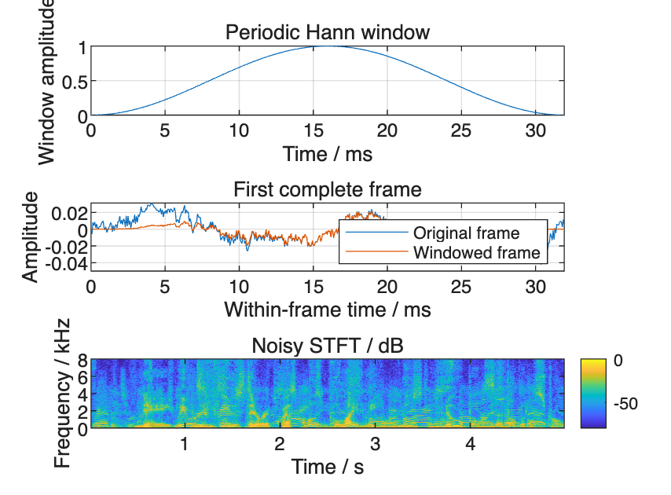

```matlab
frameInfo=table(size(Y,1),size(Y,2),sum(meta.fullFrames), ...
 'VariableNames',{'One_sided_bins','Total_frames','Complete_frames'});disp(frameInfo);
```

```matlabTextOutput
    One_sided_bins    Total_frames    Complete_frames
    ______________    ____________    _______________

         513              630               622
```

Figure 4 and Table 9: Each windowed frame produces 513 one-sided frequency bins. The spectrogram shows frames fully contained in the original signal, with power relative to the maximum noisy STFT power. Padded boundary frames are retained for inverse transformation.

# 7. Inverse transformation and reconstruction error

Reconstruct the noisy signal from its unmodified STFT and measure the error. Apply the IFFT to each frame, window and overlap-add the results, normalize by the overlapping window weights, and remove the padding. p_istft() implements this same weighted overlap-add reconstruction for subsequent processing steps.

```matlab
assert(exist('Y','var')==1,'Run Section 6 first.');
reconstructedPadded=zeros(meta.paddedLength,1);windowWeights=reconstructedPadded;
for m=1:size(Y,2)
 twoSided=[Y(:,m);conj(Y(end-1:-1:2,m))];
 frame=real(ifft(twoSided,F));
 indices=starts(m):starts(m)+L-1;
 reconstructedPadded(indices)=reconstructedPadded(indices)+frame(1:L).*hannWindow;
 windowWeights(indices)=windowWeights(indices)+hannWindow.^2;
end
keep=L+(1:N);assert(all(windowWeights(keep)>1e-8));
reconstructed=reconstructedPadded(keep)./windowWeights(keep);
reconstructionError=reconstructed-noisy;
relativeReconstructionError=norm(reconstructionError)/norm(noisy);
reconstructionCheck=table(relativeReconstructionError,max(abs(reconstructionError)), ...
 'VariableNames',{'Relative_reconstruction_error','Maximum_absolute_error'});disp(reconstructionCheck);
```

```matlabTextOutput
    Relative_reconstruction_error    Maximum_absolute_error
    _____________________________    ______________________

             1.7666e-16                    2.2204e-16
```

```matlab
assert(relativeReconstructionError<1e-12,'STFT reconstruction check failed.');
figure('Color','w');tiledlayout(2,1,'TileSpacing','compact');
nexttile;plot(time,noisy);hold on;plot(time,reconstructed,'--');
xlabel('Time / s');ylabel('Amplitude');legend('Original noisy speech','Reconstructed speech');title('Reconstruction from unmodified STFT');grid on;
nexttile;plot(time,reconstructionError);xlabel('Time / s');ylabel('Error');title('Reconstructed minus original signal');grid on;
```

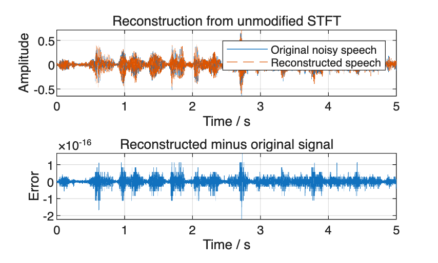

Figure 5 and Table 10: The reconstructed and original noisy waveforms overlap. The relative reconstruction error is approximately 1.8 × 10⁻¹⁶, showing that the STFT and inverse transformation accurately reconstruct the input.

# 8. Estimate noise power and examine estimation error

Rank complete frames by spectral RMS, then average the power spectra of approximately the lowest 20% to estimate noise power. p_noise_psd() estimates noise power from the observed STFT; clean speech and added noise are used only for the separate diagnostics. p_stft() also supplies their reference spectra.

```matlab
assert(exist('relativeReconstructionError','var')==1,'Run Section 7 first.');
noisyPower=abs(Y).^2;
frameLevel=sqrt(mean(noisyPower,1));
selectionThreshold=prctile(frameLevel(meta.fullFrames),cfg.noisePercentile);
selected=false(1,size(Y,2));
selected(meta.fullFrames)=frameLevel(meta.fullFrames)<=selectionThreshold;
estimatedNoisePSD=mean(noisyPower(:,selected),2);
Pnoise=repmat(estimatedNoisePSD,1,size(Y,2));
assert(any(selected) && all(isfinite(Pnoise(:))));
figure('Color','w');tiledlayout(2,1,'TileSpacing','compact');
nexttile;plot(frameTime(meta.fullFrames),frameLevel(meta.fullFrames));hold on;
scatter(frameTime(selected),frameLevel(selected),12,'filled');yline(selectionThreshold,'--');
xlabel('Time / s');ylabel('Frame spectral RMS');legend('Complete frames','Selected noise-estimation frames','20th percentile');title('Frame selection from noisy input only');grid on;
nexttile;plot(frequency/1000,10*log10(max(estimatedNoisePSD,realmin)));
xlabel('Frequency / kHz');ylabel('Power / dB');title('Estimated noise power spectrum');grid on;
```

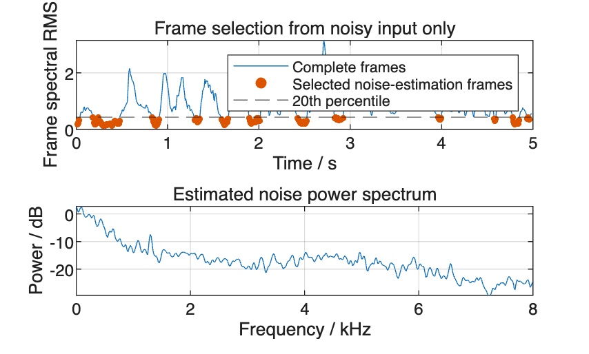

Figure 6: Low-power frames selected from the noisy utterance for noise estimation. Next, use the known noise to examine estimation accuracy and the clean reference to check whether the selected frames still contain speech.

```matlab
X=p_stft(clean,cfg);D=p_stft(noiseComponent,cfg);
trueNoisePSD=mean(abs(D(:,meta.fullFrames)).^2,2);
cleanFrameLevel=sqrt(mean(abs(X).^2,1));
energyActive=cleanFrameLevel>=max(cleanFrameLevel(meta.fullFrames))*10^(-30/20);
mainNoiseBias=10*log10(sum(estimatedNoisePSD)/sum(trueNoisePSD));
mainActivity=100*mean(energyActive(selected));
mainDiagnostic=table(sum(selected),100*mean(selected(meta.fullFrames)),mainNoiseBias,mainActivity, ...
 'VariableNames',{'Selected_frames','Selected_complete_frames_pct','Noise_PSD_power_bias_dB','Selected_active_frames_pct'});disp(mainDiagnostic);
```

```matlabTextOutput
    Selected_frames    Selected_complete_frames_pct    Noise_PSD_power_bias_dB    Selected_active_frames_pct
    _______________    ____________________________    _______________________    __________________________

          124                     19.936                       -4.3121                      64.516
```

```matlab
figure('Color','w');reference=max(trueNoisePSD);
plot(frequency/1000,10*log10(max(trueNoisePSD/reference,1e-12)));hold on;
plot(frequency/1000,10*log10(max(estimatedNoisePSD/reference,1e-12)));
xlabel('Frequency / kHz');ylabel('Relative power / dB');legend('True noise','Estimated noise');title('Noise-power estimation diagnostic');grid on;
```

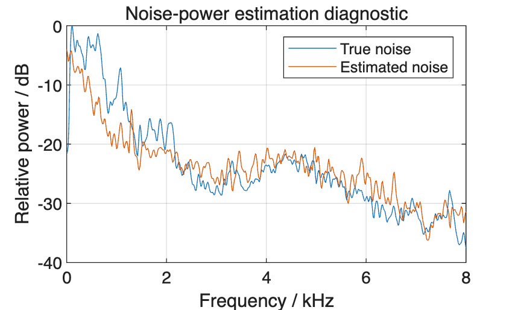

```matlab
% Use the same clean utterance in three noise categories; select the first listed 5 dB condition in each.
classes=["LowVariation";"HighVariation";"Babble"];
sourceIDs=strings(3,1);conditionIDs=sourceIDs;bias=zeros(3,1);activity=bias;selectedCount=bias;
for j=1:3
 r=candidates(candidates.UtteranceID==sample.UtteranceID & ...
  candidates.SpeechStartSample==sample.SpeechStartSample & candidates.NoiseClass==classes(j),:);
 r=sortrows(r,'ConditionID');r=r(1,:);
 [v,sr]=audioread(local_noise_path(ctx,r.NoiseClass,r.NoiseSourceID));assert(sr==fs);
 v=v(r.NoiseStartSample+(1:N));v=v-mean(v);
 k=sqrt(sum(clean.^2)/(sum(v.^2)*10^(r.InputSNR_dB/10)));d=double(single(k*v));
 Yj=p_stft(clean+d,cfg);Dj=p_stft(d,cfg);
 [Pj,selectionInfo]=p_noise_psd(Yj,meta,fs,cfg,'percentile');
 truePSD=mean(abs(Dj(:,meta.fullFrames)).^2,2);
 bias(j)=10*log10(sum(Pj(:,validFrames(1)))/sum(truePSD));
 activity(j)=100*mean(energyActive(selectionInfo.selected));selectedCount(j)=sum(selectionInfo.selected);
 sourceIDs(j)=r.NoiseSourceID;conditionIDs(j)=r.ConditionID;
end
noiseDiagnostics=table(classes,sourceIDs,conditionIDs,selectedCount,bias,activity, ...
 'VariableNames',{'Noise_category','Source','Example_condition','Selected_frames','Noise_PSD_power_bias_dB','Selected_active_frames_pct'});disp(noiseDiagnostics);
```

```matlabTextOutput
    Noise_category         Source           Example_condition       Selected_frames    Noise_PSD_power_bias_dB    Selected_active_frames_pct
    _______________    _______________    ______________________    _______________    _______________________    __________________________

    "LowVariation"     "NRIVER"           "test_base_0159_snr_5"          124                   -7.574                      54.032
    "HighVariation"    "TMETRO"           "test_base_0158_snr_5"          124                  -6.5494                      57.258
    "Babble"           "BABBLE_test_1"    "test_base_0157_snr_5"          124                  -4.3121                      64.516
```

Figure 7 and Tables 11 and 12: Power bias is the estimated-to-true noise-power ratio in decibels; negative values indicate underestimation. A clean-speech frame is marked active when its energy is within 30 dB of the strongest complete frame. This checks whether selected frames still contain speech. One example per noise category does not establish an overall difference between categories.

# 9. Calculate the time–frequency gain

Subtract α times the estimated noise power from the noisy power spectrum, with a floor of β times the original noisy power. Divide the resulting power by the original power and take the square root to obtain amplitude gain G. Multiply the original STFT by G, retaining the input phase. The batch helper p_spectral_gain() applies this same power-subtraction rule to calculate the amplitude gain.

```matlab
assert(exist('Pnoise','var')==1,'Run Section 8 first.');
estimatedSpeechPower=max(noisyPower-cfg.alpha*Pnoise,cfg.beta*noisyPower);
G=sqrt(estimatedSpeechPower./max(noisyPower,realmin));
G(noisyPower==0)=sqrt(cfg.beta);
assert(all(isfinite(G(:))) && all(G(:)>=0) && all(G(:)<=1+1e-12));
figure('Color','w');imagesc(frameTime(meta.fullFrames),frequency/1000,G(:,meta.fullFrames));
axis xy;clim([0 1]);colorbar;xlabel('Time / s');ylabel('Frequency / kHz');title('Spectral-subtraction amplitude gain G');
```

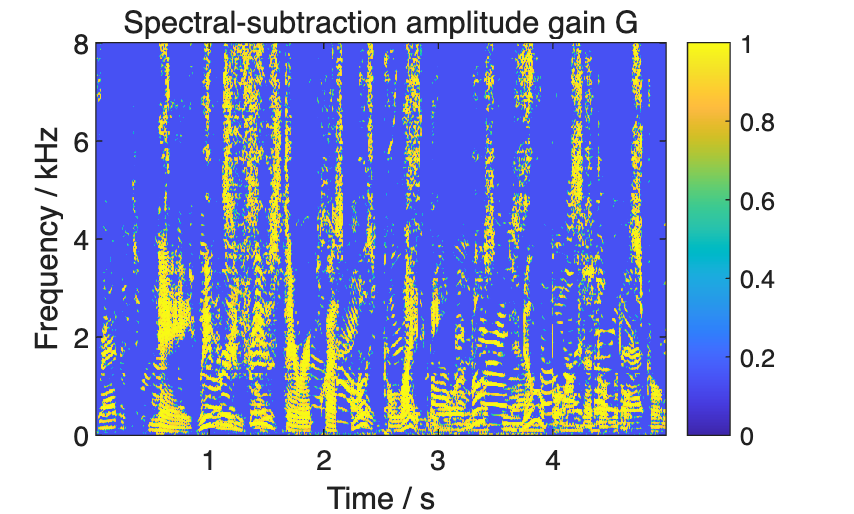

```matlab
gainInfo=table(cfg.alpha,cfg.beta,min(G(:)),median(G(:)),max(G(:)), ...
 'VariableNames',{'alpha','beta','Minimum_gain','Median_gain','Maximum_gain'});disp(gainInfo);
```

```matlabTextOutput
    alpha    beta    Minimum_gain    Median_gain    Maximum_gain
    _____    ____    ____________    ___________    ____________

     1.5     0.02      0.14142         0.14142        0.99986
```

Figure 8 and Table 13: Gains closer to 1 produce less attenuation; gains closer to the lower bound √β produce more attenuation. Speech and noise at the same time–frequency location receive the same gain, so noise suppression can also attenuate speech.

# 10. Reconstruct enhanced speech

Multiply the noisy STFT by G, then apply the inverse transformation to obtain the enhanced waveform.

```matlab
assert(exist('G','var')==1,'Run Section 9 first.');
enhancedSTFT=G.*Y;
enhanced=p_istft(enhancedSTFT,meta);
assert(numel(enhanced)==N && all(isfinite(enhanced)));
figure('Color','w');tiledlayout(2,1,'TileSpacing','compact');
nexttile;plot(time,noisy);hold on;plot(time,enhanced);xlabel('Time / s');ylabel('Amplitude');
legend('Noisy speech','Spectral-subtraction output');title('Noisy and enhanced waveforms');grid on;
nexttile;plot(time,enhanced-noisy);xlabel('Time / s');ylabel('Amplitude difference');title('Enhanced minus noisy waveform');grid on;
```

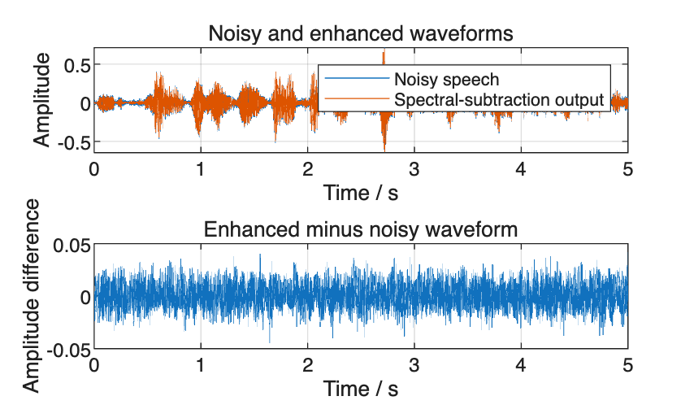

```matlab
figure('Color','w','Position',[100 100 1100 430]);tiledlayout(1,3,'TileSpacing','compact');
spectra={X,Y,enhancedSTFT};titles=["Clean reference","Noisy input","Spectral-subtraction output"];
for j=1:3
 nexttile;imagesc(frameTime(meta.fullFrames),frequency/1000, ...
  10*log10(max(abs(spectra{j}(:,meta.fullFrames)).^2/spectralReference,1e-12)));
 axis xy;clim([-80 0]);xlabel('Time / s');ylabel('Frequency / kHz');title(titles(j));
end
sharedColorbar=colorbar;sharedColorbar.Layout.Tile='east';
```

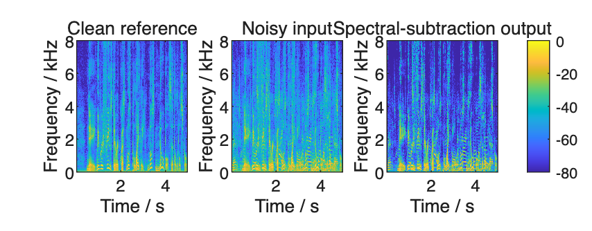

Figure 9: Noisy and enhanced waveforms and their difference. Figure 10: Clean, noisy and enhanced spectrograms. The three spectrograms share the same color reference and range. Next, calculate SI-SDR, STOI and retained speech energy.

# 11. Calculate SI-SDR, STOI and retained speech energy

SI-SDR measures waveform agreement with clean speech while allowing an overall amplitude scaling of the clean reference. STOI estimates speech intelligibility. Higher values are better for both; speaker verification is evaluated separately below. p_metrics() collects the corresponding waveform-quality and decomposition measures in the batch workflow.

```matlab
assert(exist('enhanced','var')==1,'Run Section 10 first.');
methods=["Noisy";"Percentile spectral subtraction"];
signals={noisy,enhanced};siSDR=zeros(2,1);stoiValues=siSDR;
centeredClean=clean-mean(clean);
for j=1:2
 z=signals{j};centeredOutput=z-mean(z);
 referenceScale=(centeredClean'*centeredOutput)/max(centeredClean'*centeredClean,realmin);
 target=referenceScale*centeredClean;residual=centeredOutput-target;
 siSDR(j)=10*log10(max(sum(target.^2),realmin)/max(sum(residual.^2),realmin));
 stoiValues(j)=stoi(z,clean,fs);
end
% Apply the same gains separately to known speech and noise for component analysis.
enhancedSpeech=p_istft(G.*X,meta);residualNoise=p_istft(G.*D,meta);
decompositionError=norm(enhanced-(enhancedSpeech+residualNoise))/max(norm(enhanced),realmin);
assert(decompositionError<1e-11,'Speech/noise decomposition does not match the enhanced output.');
noiseReduction=[0;10*log10(sum(noiseComponent.^2)/max(sum(residualNoise.^2),realmin))];
speechRetained=[100;100*sum(enhancedSpeech.^2)/max(sum(clean.^2),realmin)];
metrics=table(methods,siSDR,siSDR-siSDR(1),stoiValues,stoiValues-stoiValues(1), ...
 noiseReduction,speechRetained,'VariableNames', ...
 {'Method','SI_SDR_dB','SI_SDR_gain_dB','STOI','STOI change','Noise_reduction_dB','Retained_speech_energy_pct'});disp(metrics);
```

```matlabTextOutput
                 Method                  SI_SDR_dB    SI_SDR_gain_dB     STOI      STOI change    Noise_reduction_dB    Retained_speech_energy_pct
    _________________________________    _________    ______________    _______    ___________    __________________    __________________________

    "Noisy"                                4.991               0        0.79941             0                0                       100
    "Percentile spectral subtraction"     5.2343         0.24332        0.78643     -0.012981          0.94432                    92.093
```

```matlab
disp(table(decompositionError,'VariableNames',{'Relative_decomposition_error'}));
```

```matlabTextOutput
    Relative_decomposition_error
    ____________________________

             1.9207e-16
```

```matlab
save(fullfile(ctx.runRoot,'phase1_workspace.mat'),'ctx','sample','clean','noise','noiseComponent', ...
 'noisy','Y','X','D','meta','G','enhanced','enhancedSpeech','residualNoise','metrics', ...
 'snrCheck','maximumSNRError','relativeReconstructionError','decompositionError','noiseDiagnostics', ...
 'selected','estimatedNoisePSD','Pnoise','-v7');
```

Tables 14 and 15: SI-SDR gain and STOI change are relative to the same noisy utterance. Spectral subtraction increases SI-SDR by approximately 0.24 dB but reduces STOI by approximately 0.013. Noise reduction is approximately 0.94 dB, with 92.1% of speech energy retained. The complete test set is used later to compare verification performance.

# 12. Generate development mixtures

A Python helper generates 624 development mixtures using the same energy-ratio formula as Sections 4–5; the MATLAB example demonstrates one pair. Development metrics are then used to select subtraction parameters and decision thresholds. p_initialize_dataset() prepares the development directory and fixed input lists. p_run_python() calls the Python preparation script and writes its process output to a log.

```matlab
assert(exist('ctx','var')==1,'Run Section 1 first.');
devRoot=p_initialize_dataset(ctx,"development");
p_run_python(ctx,'experiment_io.py','prepare','--root',devRoot);
% Historical filename: this file contains development rows only; the split is checked by the pipeline.
devInputs=readtable(fullfile(devRoot,'inputs','test_conditions.csv'),'Delimiter',',','ReadVariableNames',true,'TextType','string');
disp(groupsummary(devInputs,{'ParticipantRole','NoiseClass','InputSNR_dB'}));
```

```matlabTextOutput
       ParticipantRole          NoiseClass       InputSNR_dB    GroupCount
    ______________________    _______________    ___________    __________

    "external_development"    "Babble"               -5             12
    "external_development"    "Babble"                0             12
    "external_development"    "Babble"                5             12
    "external_development"    "Babble"               10             12
    "external_development"    "HighVariation"        -5             12
    "external_development"    "HighVariation"         0             12
    "external_development"    "HighVariation"         5             12
    "external_development"    "HighVariation"        10             12
    "external_development"    "LowVariation"         -5             12
    "external_development"    "LowVariation"          0             12
    "external_development"    "LowVariation"          5             12
    "external_development"    "LowVariation"         10             12
    "target"                  "Babble"               -5             40
    "target"                  "Babble"                0             40
    "target"                  "Babble"                5             40
    "target"                  "Babble"               10             40
    "target"                  "HighVariation"        -5             40
    "target"                  "HighVariation"         0             40
    "target"                  "HighVariation"         5             40
    "target"                  "HighVariation"        10             40
    "target"                  "LowVariation"         -5             40
    "target"                  "LowVariation"          0             40
    "target"                  "LowVariation"          5             40
    "target"                  "LowVariation"         10             40
```

```matlab
developmentSNR=max(abs(devInputs.MeasuredSNR_dB-devInputs.InputSNR_dB));
disp(table(developmentSNR,'VariableNames',{'Maximum_SNR_error_dB'}));
```

```matlabTextOutput
    Maximum_SNR_error_dB
    ____________________

         7.5911e-08
```

Tables 16 and 17: Development-mixture counts by condition and the maximum deviation of measured SNR from its specified value.

# 13. Development: traditional methods

Run percentile spectral subtraction at five α values. SS_a1p5 denotes α = 1.5; other α labels follow the same convention. VAD_SS initializes noise power from the first 32 complete frames, determined by the nominal 0.25 s initialization setting and 8 ms hop. It then updates noise power on frames selected using two frame-level thresholds and a tracked noise floor. Tracking_SS uses the VOICEBOX minimum-statistics estimator to track noise power over time. All three use the same subtraction-gain formula. p_run_matlab_stage() invokes the MATLAB batch processing; run_test_dsp() applies the traditional methods and records their signal metrics.

```matlab
assert(exist('devRoot','var')==1,'Run Sections 1–12 in order first.');
p_run_matlab_stage(devRoot,"traditional");
devQuality=readtable(fullfile(devRoot,'dsp','signal_metrics.csv'),'Delimiter',',','ReadVariableNames',true,'TextType','string');
disp(groupsummary(devQuality(devQuality.ParticipantRole=="target",:),'Method','mean',{'SI_SDRImprovement_dB','STOIChange'}));
```

```matlabTextOutput
       Method        GroupCount    mean_SI_SDRImprovement_dB    mean_STOIChange
    _____________    __________    _________________________    _______________

    "Noisy"             480                1.674e-16              2.8912e-18
    "SS_a0p5"           480                   0.4984              0.00018977
    "SS_a1p0"           480                  0.92612              -0.0011465
    "SS_a1p5"           480                   1.2894              -0.0029527
    "SS_a2p0"           480                   1.5948              -0.0049906
    "SS_a3p0"           480                    2.068              -0.0093487
    "Tracking_SS"       480                   1.8695               0.0027727
    "VAD_SS"            480                   1.2134               -0.022317
```

Table 18: Mean SI-SDR gain and STOI change for development mixtures from enrolled speakers.

# 14. Development: models, scoring and parameter selection

Use pretrained DeepFilterNet3 for enhancement and ECAPA to extract 192-dimensional speaker embeddings. Neither model is trained or fine-tuned. Set the additional DeepFilterNet input gain to 1 and compensate its output delay. p_deepfilter_settings() reads the settings recorded by this run. After embeddings are extracted, p_experiment_scores() forms cosine scores; p_choose_alpha() and p_choose_threshold() implement the development selection rules.

EER is the error rate at the intersection of false-acceptance and false-rejection rates. BER is their average at a specified decision threshold. Development parameter selection uses genuine and external-impostor trials.

```matlab
assert(exist('devRoot','var')==1 && exist('devQuality','var')==1,'Run Sections 1–13 in order first.');
p_run_python(ctx,'run_deepfilter.py',devRoot);
disp(p_deepfilter_settings(devRoot));
```

```matlabTextOutput
    Model_sample_rate_Hz    Aligned_output_rate_Hz    Delay_compensation_48k_samples    Additional_input_gain
    ____________________    ______________________    ______________________________    _____________________

           48000                    16000                          1440                           1
```

```matlab
p_run_matlab_stage(devRoot,"external_quality");
devQuality=readtable(fullfile(devRoot,'external','complete_signal_metrics.csv'),'Delimiter',',','ReadVariableNames',true,'TextType','string');
disp(groupsummary(devQuality(devQuality.ParticipantRole=="target",:),'Method','mean',{'SI_SDRImprovement_dB','STOIChange'}));
```

```matlabTextOutput
        Method         GroupCount    mean_SI_SDRImprovement_dB    mean_STOIChange
    _______________    __________    _________________________    _______________

    "Adapter"             480                -0.003031              1.2568e-06
    "DeepFilterNet"       480                   8.2105                0.023757
    "Noisy"               480                1.674e-16              2.8912e-18
    "Resample_only"       480               -0.0030306              1.2955e-06
    "SS_a0p5"             480                   0.4984              0.00018977
    "SS_a1p0"             480                  0.92612              -0.0011465
    "SS_a1p5"             480                   1.2894              -0.0029527
    "SS_a2p0"             480                   1.5948              -0.0049906
    "SS_a3p0"             480                    2.068              -0.0093487
    "Tracking_SS"         480                   1.8695               0.0027727
    "VAD_SS"              480                   1.2134               -0.022317
```

Tables 19 and 20: Model settings from this run and development signal metrics.

```matlab
assert(exist('devQuality','var')==1 && isfile(fullfile(devRoot,'external','complete_signal_metrics.csv')),'Run the preceding development model step first.');
p_run_python(ctx,'extract_embeddings.py',devRoot);
p_run_python(ctx,'experiment_io.py','export_embeddings','--root',devRoot);
dev=p_experiment_scores(devRoot);
disp(table(height(dev.Q),numel(dev.methods),nnz(dev.genuine),nnz(dev.external),'VariableNames',{'Mixtures','Methods','Genuine_trials','External_impostor_trials'}));
```

```matlabTextOutput
    Mixtures    Methods    Genuine_trials    External_impostor_trials
    ________    _______    ______________    ________________________

      624         11            480                    2880
```

Table 21: Development scoring dimensions. Genuine and external-impostor scores are used for the following calibration step.

```matlab
assert(exist('dev','var')==1,'Run the preceding development embedding step first.');
mask=dev.genuine|dev.external;
noisyIndex=find(dev.methods=="Noisy");developmentScores=dev.scores(:,:,noisyIndex,1);
thresholdSelection=p_choose_threshold(developmentScores(mask),dev.genuine(mask));
parameters=struct('common_threshold',thresholdSelection.threshold,'per_method_thresholds',struct);
methodThresholds=zeros(numel(dev.methods),1);methodBER=methodThresholds;
for k=1:numel(dev.methods)
 sc=dev.scores(:,:,k,1);calibration=p_choose_threshold(sc(mask),dev.genuine(mask));
 methodThresholds(k)=calibration.threshold;methodBER(k)=100*calibration.BER;
 parameters.per_method_thresholds.(char(dev.methods(k)))=struct('threshold',calibration.threshold);
end
devCalibration=table(dev.methods,methodThresholds,methodBER, ...
 'VariableNames',{'Method','DevelopmentThreshold','DevelopmentBER_pct'});disp(devCalibration);
```

```matlabTextOutput
        Method         DevelopmentThreshold    DevelopmentBER_pct
    _______________    ____________________    __________________

    "Adapter"                0.26873                 6.0938
    "DeepFilterNet"          0.27551                 7.5174
    "Noisy"                  0.27008                 6.0417
    "Resample_only"          0.26879                 6.0938
    "SS_a0p5"                 0.2741                 7.4653
    "SS_a1p0"                0.30697                 8.2465
    "SS_a1p5"                0.28943                 8.6111
    "SS_a2p0"                0.27249                 9.0278
    "SS_a3p0"                0.32555                 9.0972
    "Tracking_SS"            0.26438                 6.7708
    "VAD_SS"                  0.3023                 9.1319
```

```matlab
devSummary=p_experiment_summary(dev,devQuality,parameters);
alphas=ctx.parameters.candidate_alphas(:);alphaMethods=["SS_a0p5";"SS_a1p0";"SS_a1p5";"SS_a2p0";"SS_a3p0"];
devMain=devSummary(devSummary.ReferenceSet=="enrollment_primary",:);
[ok,ix]=ismember(alphaMethods,devMain.Method);assert(all(ok));
selection=p_choose_alpha(alphas,devMain.TargetSI_SDRGain_dB(ix),devMain.ExternalEER_pct(ix)/100);
parameters.quality_alpha=selection.quality_alpha;parameters.identity_alpha=selection.identity_alpha;
parameters.quality_method=alphaMethods(selection.quality_index);parameters.identity_method=alphaMethods(selection.identity_index);
selectionTable=table(selection.quality_alpha,selection.identity_alpha,parameters.common_threshold, ...
 'VariableNames',{'SI_SDR_selected_alpha','EER_selected_alpha','Noisy_development_threshold'});disp(selectionTable);
```

```matlabTextOutput
    SI_SDR_selected_alpha    EER_selected_alpha    Noisy_development_threshold
    _____________________    __________________    ___________________________

              3                     0.5                      0.27008
```

```matlab
fprintf('Decision threshold: %.6f\n',parameters.common_threshold);
```

```matlabTextOutput
Decision threshold: 0.270079
```

```matlab
disp(devMain(:,{'Method','TargetSI_SDRGain_dB','TargetSTOIChange','ExternalEER_pct'}));
```

```matlabTextOutput
        Method         TargetSI_SDRGain_dB    TargetSTOIChange    ExternalEER_pct
    _______________    ___________________    ________________    _______________

    "Adapter"               -0.003031            1.2568e-06           7.0833
    "DeepFilterNet"            8.2105              0.023757           9.5833
    "Noisy"                 1.674e-16            2.8912e-18           7.0833
    "Resample_only"        -0.0030306            1.2955e-06           7.1181
    "SS_a0p5"                  0.4984            0.00018977           8.5417
    "SS_a1p0"                 0.92612            -0.0011465           9.6181
    "SS_a1p5"                  1.2894            -0.0029527           10.347
    "SS_a2p0"                  1.5948            -0.0049906           10.312
    "SS_a3p0"                   2.068            -0.0093487           10.625
    "Tracking_SS"              1.8695             0.0027727           7.9514
    "VAD_SS"                   1.2134             -0.022317            11.25
```

```matlab
mkdir(fullfile(devRoot,'results'));
writetable(devCalibration,fullfile(devRoot,'results','development_calibration.csv'));
writetable(devSummary,fullfile(devRoot,'results','development_summary.csv'));
writetable(selectionTable,fullfile(devRoot,'results','development_selection.csv'));
save(fullfile(ctx.runRoot,'development_parameters.mat'),'parameters','selection','-v7');
```

Tables 22–24: Maximum mean development SI-SDR selects α = 3, while minimum external-verification EER selects α = 0.5. Noisy development scores select a BER-minimizing threshold of approximately 0.270079. The test experiment uses these computed parameters without further adjustment.

# 15. Generate test mixtures

A Python helper generates 1080 test mixtures using the same formula as Sections 4–5.

```matlab
assert(exist('ctx','var')==1 && exist('parameters','var')==1,'Run Sections 1–14 in order first.');
root=p_initialize_dataset(ctx,"test");
p_run_python(ctx,'experiment_io.py','prepare','--root',root);
queries=readtable(fullfile(root,'inputs','test_conditions.csv'),'Delimiter',',','ReadVariableNames',true,'TextType','string');
disp(groupsummary(queries,{'ParticipantRole','NoiseClass','InputSNR_dB'}));
```

```matlabTextOutput
    ParticipantRole      NoiseClass       InputSNR_dB    GroupCount
    _______________    _______________    ___________    __________

    "external_test"    "Babble"               -5             30
    "external_test"    "Babble"                0             30
    "external_test"    "Babble"                5             30
    "external_test"    "Babble"               10             30
    "external_test"    "HighVariation"        -5             30
    "external_test"    "HighVariation"         0             30
    "external_test"    "HighVariation"         5             30
    "external_test"    "HighVariation"        10             30
    "external_test"    "LowVariation"         -5             30
    "external_test"    "LowVariation"          0             30
    "external_test"    "LowVariation"          5             30
    "external_test"    "LowVariation"         10             30
    "target"           "Babble"               -5             60
    "target"           "Babble"                0             60
    "target"           "Babble"                5             60
    "target"           "Babble"               10             60
    "target"           "HighVariation"        -5             60
    "target"           "HighVariation"         0             60
    "target"           "HighVariation"         5             60
    "target"           "HighVariation"        10             60
    "target"           "LowVariation"         -5             60
    "target"           "LowVariation"          0             60
    "target"           "LowVariation"          5             60
    "target"           "LowVariation"         10             60
```

```matlab
testSNR=max(abs(queries.MeasuredSNR_dB-queries.InputSNR_dB));
disp(table(testSNR,'VariableNames',{'Maximum_SNR_error_dB'}));
```

```matlabTextOutput
    Maximum_SNR_error_dB
    ____________________

         5.5644e-08
```

Tables 25 and 26: Test-mixture counts by speaker group, noise category and SNR, and the maximum SNR deviation.

# 16. Test: traditional methods and component decomposition

Apply the same five α values of percentile spectral subtraction, VAD_SS and Tracking_SS to the test set, then calculate their metrics.

```matlab
assert(exist('root','var')==1 && exist('queries','var')==1,'Run Sections 1–15 in order first.');
p_run_matlab_stage(root,"traditional");
quality=readtable(fullfile(root,'dsp','signal_metrics.csv'),'Delimiter',',','ReadVariableNames',true,'TextType','string');
disp(groupsummary(quality(quality.ParticipantRole=="target",:),'Method','mean', ...
 {'SI_SDRImprovement_dB','STOIChange','NoiseReduction_dB','SpeechRetained_pct'}));
```

```matlabTextOutput
       Method        GroupCount    mean_SI_SDRImprovement_dB    mean_STOIChange    mean_NoiseReduction_dB    mean_SpeechRetained_pct
    _____________    __________    _________________________    _______________    ______________________    _______________________

    "Noisy"             720               7.3387e-17              -4.3175e-18           -1.3486e-14                     100
    "SS_a0p5"           720                  0.40582               0.00010937               0.71451                  94.656
    "SS_a1p0"           720                  0.70282               -0.0015224                1.2664                  91.195
    "SS_a1p5"           720                   0.9293                -0.003706                1.7376                  88.404
    "SS_a2p0"           720                   1.1046               -0.0061625                2.1523                   86.03
    "SS_a3p0"           720                   1.3475                -0.011181                2.8628                    82.1
    "Tracking_SS"       720                   1.1674                0.0015701                1.9049                  90.381
    "VAD_SS"            720                  0.50563                -0.023239                4.0581                  67.255
```

Table 27: Mean noise reduction, retained speech energy, SI-SDR gain and STOI change for the traditional methods.

# 17. Test: DeepFilterNet and signal-transfer controls

Resample noisy speech from 16 to 48 kHz, apply DeepFilterNet, compensate its output delay and resample to 16 kHz. Resample_only performs resampling alone. Adapter additionally applies PCM16 quantization to examine the effects of resampling and quantization.

```matlab
assert(exist('root','var')==1 && exist('quality','var')==1,'Run Sections 1–16 in order first.');
p_run_python(ctx,'run_deepfilter.py',root);
disp(p_deepfilter_settings(root));
```

```matlabTextOutput
    Model_sample_rate_Hz    Aligned_output_rate_Hz    Delay_compensation_48k_samples    Additional_input_gain
    ____________________    ______________________    ______________________________    _____________________

           48000                    16000                          1440                           1
```

```matlab
p_run_matlab_stage(root,"external_quality");
quality=readtable(fullfile(root,'external','complete_signal_metrics.csv'),'Delimiter',',','ReadVariableNames',true,'TextType','string');
qualitySummary=groupsummary(quality,{'ParticipantRole','Method'},'mean',{'SI_SDRImprovement_dB','STOIChange'});disp(qualitySummary);
```

```matlabTextOutput
    ParticipantRole        Method         GroupCount    mean_SI_SDRImprovement_dB    mean_STOIChange
    _______________    _______________    __________    _________________________    _______________

    "external_test"    "Adapter"             360               -0.0090627                5.442e-08
    "external_test"    "DeepFilterNet"       360                   6.3177                 0.024107
    "external_test"    "Noisy"               360               7.8053e-18               7.7099e-18
    "external_test"    "Resample_only"       360               -0.0090624               9.3479e-08
    "external_test"    "SS_a0p5"             360                  0.40784               0.00033942
    "external_test"    "SS_a1p0"             360                   0.7076              -0.00088001
    "external_test"    "SS_a1p5"             360                  0.93672               -0.0027154
    "external_test"    "SS_a2p0"             360                   1.1139               -0.0048373
    "external_test"    "SS_a3p0"             360                   1.3576               -0.0094276
    "external_test"    "Tracking_SS"         360                   1.1415                0.0015551
    "external_test"    "VAD_SS"              360                  0.46453                -0.022722
    "target"           "Adapter"             720                -0.019334              -7.1393e-09
    "target"           "DeepFilterNet"       720                    6.258                 0.029086
    "target"           "Noisy"               720               7.3387e-17              -4.3175e-18
    "target"           "Resample_only"       720                -0.019334               3.9824e-08
    "target"           "SS_a0p5"             720                  0.40582               0.00010937
    "target"           "SS_a1p0"             720                  0.70282               -0.0015224
    "target"           "SS_a1p5"             720                   0.9293                -0.003706
    "target"           "SS_a2p0"             720                   1.1046               -0.0061625
    "target"           "SS_a3p0"             720                   1.3475                -0.011181
    "target"           "Tracking_SS"         720                   1.1674                0.0015701
    "target"           "VAD_SS"              720                  0.50563                -0.023239
```

```matlab
figure('Color','w','Position',[100 100 1100 450]);targetQuality=qualitySummary(qualitySummary.ParticipantRole=="target",:);
tiledlayout(1,2);nexttile;bar(categorical(targetQuality.Method),targetQuality.mean_SI_SDRImprovement_dB);ylabel('SI-SDR gain / dB');xtickangle(45);grid on;
nexttile;bar(categorical(targetQuality.Method),targetQuality.mean_STOIChange);ylabel('STOI change');xtickangle(45);grid on;
```

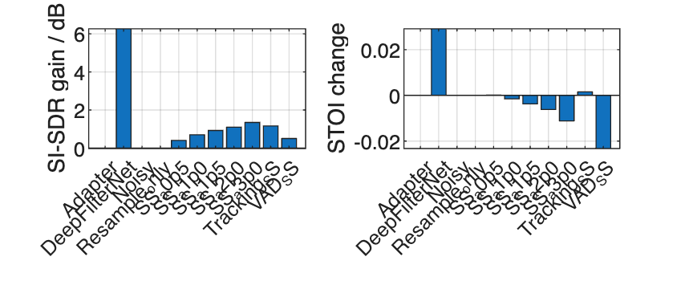

Table 28 reads delay and gain settings from this run’s DeepFilterNet audit. Table 29 separates enrolled and unenrolled speakers; Figure 11 shows enrolled-speaker means. DeepFilterNet does not expose the explicit time–frequency gain used in this decomposition, so retained speech energy is not computed for it by this procedure.

# 18. Extract embeddings and compute cosine scores

ECAPA extracts a 192-dimensional speaker embedding from each five-second recording. Normalize the embeddings and calculate cosine similarity with each of the 20 enrollment embeddings. Higher scores indicate greater similarity between the speaker characteristics represented by the model. p_experiment_scores() also associates each score with its enrollment reference and genuine or impostor trial label.

```matlab
assert(exist('root','var')==1 && exist('quality','var')==1,'Run Sections 1–17 in order first.');
p_run_python(ctx,'extract_embeddings.py',root);
p_run_python(ctx,'experiment_io.py','export_embeddings','--root',root);
experiment=p_experiment_scores(root);
scoreShape=size(experiment.scores);
disp(table(height(experiment.Q),scoreShape(2),numel(experiment.methods),scoreShape(4), ...
 'VariableNames',{'Test_mixtures','Enrollment_comparisons_per_query','Methods','Enrollment_sets'}));
```

```matlabTextOutput
    Test_mixtures    Enrollment_comparisons_per_query    Methods    Enrollment_sets
    _____________    ________________________________    _______    _______________

        1080                        20                     11              2
```

```matlab
disp(table(nnz(experiment.genuine),nnz(experiment.external),nnz(experiment.internal), ...
 'VariableNames',{'Genuine_trials_per_method','External_impostor_trials_per_method','Internal_impostor_trials_per_method'}));
```

```matlabTextOutput
    Genuine_trials_per_method    External_impostor_trials_per_method    Internal_impostor_trials_per_method
    _________________________    ___________________________________    ___________________________________

               720                              7200                                   13680
```

```matlab
% Show the noisy-query/enrollment cosine score for one genuine trial.
embeddingData=load(fullfile(root,'external','embeddings.mat'));vectors=double(embeddingData.embeddings);
vectors=vectors./vecnorm(vectors,2,2);clipIDs=string(embeddingData.clip_ids);
firstQuery=find(experiment.Q.ParticipantRole=="target",1);queryID=experiment.Q.ConditionID(firstQuery)+"_Noisy";
clipIndex=readtable(fullfile(root,'external','complete_clip_index.csv'),'Delimiter',',','ReadVariableNames',true,'TextType','string');
reference=clipIndex(clipIndex.RecordingRole=="enrollment_primary" & clipIndex.SpeakerID==experiment.Q.SpeakerID(firstQuery),:);
[~,qix]=ismember(queryID,clipIDs);[~,rix]=ismember(reference.ClipID,clipIDs);
exampleCosine=vectors(qix,:)*vectors(rix,:)';disp(table(queryID,reference.ClipID,exampleCosine, ...
 'VariableNames',{'Test_recording','Enrollment_recording','Cosine_score'}));
```

```matlabTextOutput
           Test_recording            Enrollment_recording     Cosine_score
    _____________________________    _____________________    ____________

    "test_base_0157_snr_-5_Noisy"    "clean_61-70968-0005"      0.12101
```

Tables 30–32: Scoring dimensions, trial counts and one genuine-score example. Genuine trials compare the same speaker’s test and enrollment recordings. Internal-impostor trials use other enrolled speakers; external-impostor trials use unenrolled speakers. The primary analysis uses genuine and external-impostor trials.

# 19. Calculate EER, BER, FAR and FRR

FAR is the proportion of impostor trials incorrectly accepted; FRR is the proportion of genuine trials incorrectly rejected. BER = (FAR + FRR)/2. EER is interpolated at the crossing of FAR and FRR as the threshold varies, and is independent of a particular fixed decision threshold. The main BER, FAR and FRR use the common threshold selected from Noisy development scores. OwnDevThresholdBER separately uses the threshold selected for each method on development data. p_verification_metrics() calculates these rates from scores and labels. p_experiment_summary() combines them with the waveform metrics for each system.

```matlab
assert(exist('experiment','var')==1 && exist('quality','var')==1 && exist('parameters','var')==1,'Run Sections 1–18 in order first.');
resultSummary=p_experiment_summary(experiment,quality,parameters);
primary=resultSummary(resultSummary.ReferenceSet=="enrollment_primary",:);
disp(primary(:,{'Method','ExternalEER_pct','InternalEER_pct','CommonThresholdBER_pct', ...
 'CommonThresholdFAR_pct','CommonThresholdFRR_pct','OwnDevThresholdBER_pct'}));
```

```matlabTextOutput
        Method         ExternalEER_pct    InternalEER_pct    CommonThresholdBER_pct    CommonThresholdFAR_pct    CommonThresholdFRR_pct    OwnDevThresholdBER_pct
    _______________    _______________    _______________    ______________________    ______________________    ______________________    ______________________

    "Adapter"              7.0833             7.3611                 5.8889                    1.9167                    9.8611                    5.9028
    "DeepFilterNet"        9.0278             9.4371                 8.6806                    2.9167                    14.444                     8.875
    "Noisy"                7.0833                7.5                 5.8472                    1.8333                    9.8611                    5.8472
    "Resample_only"        7.0833             7.3611                 5.8889                    1.9167                    9.8611                    5.9028
    "SS_a0p5"              7.3611             7.6389                 6.5347                    2.5139                    10.556                    6.7014
    "SS_a1p0"              7.8472             8.4722                 7.0972                    2.8056                    11.389                    7.9583
    "SS_a1p5"              8.7639             9.1667                 7.6944                    3.1667                    12.222                    8.0556
    "SS_a2p0"              9.1667             9.1667                 8.2222                    3.3889                    13.056                    8.4028
    "SS_a3p0"              9.7222                 10                 9.0278                      3.75                    14.306                    9.8611
    "Tracking_SS"          7.6389             8.0556                 6.6736                    2.5139                    10.833                    6.7292
    "VAD_SS"                   10             10.556                 9.5208                    3.0694                    15.972                    9.9861
```

```matlab
disp(table(parameters.common_threshold,parameters.quality_alpha,parameters.identity_alpha, ...
 'VariableNames',{'Decision threshold','SI_SDR_selected_alpha','EER_selected_alpha'}));
```

```matlabTextOutput
    Decision threshold    SI_SDR_selected_alpha    EER_selected_alpha
    __________________    _____________________    __________________

         0.27008                    3                     0.5
```

```matlab
if ~isfolder(fullfile(root,'results')),mkdir(fullfile(root,'results'));end
writetable(resultSummary,fullfile(root,'results','test_summary.csv'));save(fullfile(root,'results','native_scores.mat'),'experiment','-v7');
figure('Color','w');ix=find(experiment.methods=="DeepFilterNet");s=experiment.scores(:,:,ix,1);
scoreBinEdges=linspace(min([s(experiment.genuine);s(experiment.external)]),max([s(experiment.genuine);s(experiment.external)]),41);histogram(s(experiment.genuine),scoreBinEdges,'Normalization','probability');hold on;
histogram(s(experiment.external),scoreBinEdges,'Normalization','probability');xline(parameters.common_threshold,'--');
xlabel('Cosine similarity');ylabel('Proportion');legend('Genuine','External impostor','Decision threshold');title('DeepFilterNet verification scores');
```

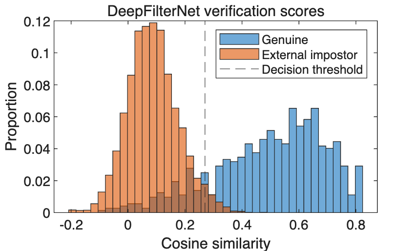

Tables 33 and 34 and Figure 12: Default subtraction and DeepFilterNet both have higher EER and BER than Noisy. At the common threshold, default subtraction increases FAR/FRR by approximately 1.33/2.36 percentage points, and DeepFilterNet by 1.08/4.58 points. FRR increases by more percentage points for these two methods.

# 20. Results by SNR, noise category and source

Calculate verification EER separately by SNR, noise category and source to compare methods under different conditions. p_conditional_verification() groups trials by noise category and SNR; p_source_verification() computes the sourcewise results.

```matlab
assert(exist('primary','var')==1 && exist('experiment','var')==1 && exist('parameters','var')==1,'Run Sections 1–19 in order first.');
main=["Noisy","SS_a1p5",string(parameters.quality_method),string(parameters.identity_method),"DeepFilterNet"];
conditional=p_conditional_verification(experiment,parameters);
% Overall SNR EER must be recalculated from pooled scores, not averaged across classes.
for level=unique(experiment.Q.InputSNR_dB)'
 mask=experiment.Q.InputSNR_dB==level;g=experiment.genuine(mask,:);ex=experiment.external(mask,:);keep=g|ex;
 for k=1:numel(experiment.methods)
  sc=experiment.scores(mask,:,k,1);v=p_verification_metrics(sc(keep),g(keep),parameters.common_threshold);
  row=table(experiment.methods(k),"ALL","ALL",level,nnz(g),nnz(ex),100*v.EER,100*v.BER,'VariableNames',conditional.Properties.VariableNames);
  conditional=[conditional;row];
 end
end
disp(conditional(conditional.NoiseClass=="ALL" & ismember(conditional.Method,main),:));
```

```matlabTextOutput
        Method         NoiseClass    NoiseSourceID    InputSNR_dB    GenuineTrials    ExternalTrials    EER_pct    BER_pct
    _______________    __________    _____________    ___________    _____________    ______________    _______    _______

    "DeepFilterNet"      "ALL"           "ALL"            -5              180              1800          18.333    21.083
    "Noisy"              "ALL"           "ALL"            -5              180              1800          16.111    16.694
    "SS_a0p5"            "ALL"           "ALL"            -5              180              1800          16.667     17.75
    "SS_a1p5"            "ALL"           "ALL"            -5              180              1800              20    19.611
    "SS_a3p0"            "ALL"           "ALL"            -5              180              1800          22.222    23.111
    "DeepFilterNet"      "ALL"           "ALL"             0              180              1800             8.5    8.4444
    "Noisy"              "ALL"           "ALL"             0              180              1800               5    4.1111
    "SS_a0p5"            "ALL"           "ALL"             0              180              1800          5.5556    5.4722
    "SS_a1p5"            "ALL"           "ALL"             0              180              1800          7.7778       7.5
    "SS_a3p0"            "ALL"           "ALL"             0              180              1800          9.2778    8.2222
    "DeepFilterNet"      "ALL"           "ALL"             5              180              1800          3.3333    3.3333
    "Noisy"              "ALL"           "ALL"             5              180              1800         0.61111    1.3056
    "SS_a0p5"            "ALL"           "ALL"             5              180              1800             1.5    1.5278
    "SS_a1p5"            "ALL"           "ALL"             5              180              1800          2.2222    2.0278
    "SS_a3p0"            "ALL"           "ALL"             5              180              1800          2.6667    2.8056
    "DeepFilterNet"      "ALL"           "ALL"            10              180              1800         0.83333    1.8611
    "Noisy"              "ALL"           "ALL"            10              180              1800         0.16667    1.2778
    "SS_a0p5"            "ALL"           "ALL"            10              180              1800         0.55556    1.3889
    "SS_a1p5"            "ALL"           "ALL"            10              180              1800         0.55556    1.6389
    "SS_a3p0"            "ALL"           "ALL"            10              180              1800         0.66667    1.9722
```

```matlab
writetable(conditional,fullfile(root,'results','conditional_verification.csv'));
figure('Color','w','Position',[100 100 1100 450]);tiledlayout(1,3);classes=["LowVariation","HighVariation","Babble"];main=["Noisy","SS_a1p5",string(parameters.quality_method),string(parameters.identity_method),"DeepFilterNet"];
for j=1:3
 nexttile;hold on;
 for method=main
  r=conditional(conditional.NoiseClass==classes(j) & conditional.Method==method & conditional.NoiseSourceID=="ALL",:);r=sortrows(r,'InputSNR_dB');plot(r.InputSNR_dB,r.EER_pct,'-o','DisplayName',method);
 end
 xlabel('SNR / dB');ylabel('External-impostor EER / %');title(classes(j));grid on;
end
legend('Location','best','Interpreter','none');
```

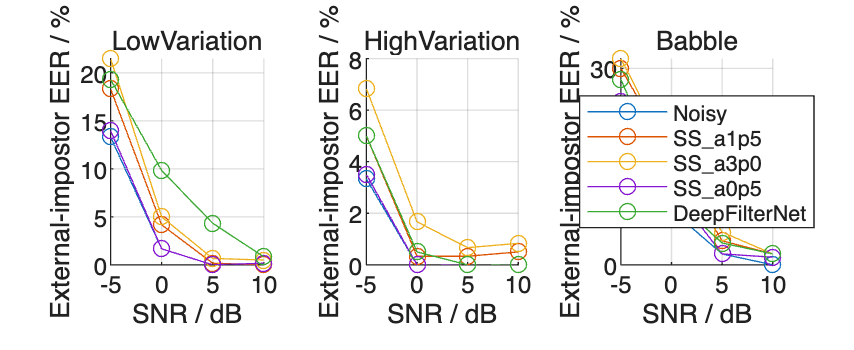

```matlab
figure('Color','w','Position',[100 100 1000 450]);sourceSummary=p_source_verification(experiment,parameters);sourceBase=sortrows(sourceSummary(sourceSummary.Method=="Noisy",:),"NoiseSourceID");
sourceSS=sortrows(sourceSummary(sourceSummary.Method=="SS_a1p5",:),"NoiseSourceID");
sourceDF=sortrows(sourceSummary(sourceSummary.Method=="DeepFilterNet",:),"NoiseSourceID");
disp(table(sourceBase.NoiseSourceID,sourceBase.EER_pct,sourceSS.EER_pct-sourceBase.EER_pct,sourceDF.EER_pct-sourceBase.EER_pct, ...
 'VariableNames',{'Noise_source','Noisy_EER_pct','SS_minus_Noisy_pp','DFN_minus_Noisy_pp'}));
```

```matlabTextOutput
     Noise_source      Noisy_EER_pct    SS_minus_Noisy_pp    DFN_minus_Noisy_pp
    _______________    _____________    _________________    __________________

    "BABBLE_test_1"         12.5                  5                       0
    "BABBLE_test_2"       15.625              3.125                   4.375
    "BABBLE_test_3"          9.5              -0.75                     0.5
    "NRIVER"               3.375                2.5                   7.375
    "OMEETING"               2.5               1.25                    1.25
    "PRESTO"                8.75               3.75                       5
    "STRAFFIC"              1.25              0.625              4.4409e-15
    "TCAR"                     0              0.625                       0
    "TMETRO"                   0               1.25                   0.875
```

```matlab
assert(~isempty(sourceSummary));
for method=main
 r=sourceSummary(sourceSummary.Method==method,:);plot(categorical(r.NoiseSourceID),r.EER_pct,'o-','DisplayName',method);hold on;
end
ylabel('External-impostor EER / %');xtickangle(45);legend('Location','best','Interpreter','none');grid on;
```

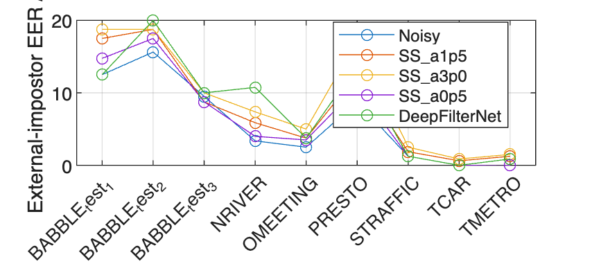

```matlab
writetable(sourceSummary,fullfile(root,'results','source_verification.csv'));
```

Table 35 and Figure 13: DeepFilterNet-minus-Noisy EER differences at −5, 0, 5 and 10 dB are approximately 2.22, 3.50, 2.72 and 0.67 percentage points, without a monotonic pattern. Table 36 and Figure 14 show uneven source differences: the DeepFilterNet difference ranges from approximately 0 to 7.38 points and is largest for NRIVER. Each source has only 80 genuine and 800 external-impostor trials; these are sourcewise point estimates. Category differences also include spectrum and background speech, so they cannot be attributed solely to energy variability.

# 21. α, waveform metrics and verification errors

Compare SI-SDR gain and verification EER across five α values. Highlight the development selections, α = 3 for SI-SDR and α = 0.5 for EER, to examine the relationship between subtraction strength and verification performance.

```matlab
assert(exist('primary','var')==1 && exist('alphaMethods','var')==1 && exist('alphas','var')==1,'Run Sections 1–19 in order first.');
[ok,ix]=ismember(alphaMethods,primary.Method);assert(all(ok));
alphaTable=table(alphas,primary.TargetSI_SDRGain_dB(ix),primary.TargetSTOIChange(ix),primary.ExternalEER_pct(ix), ...
 'VariableNames',{'alpha','SISDRGain_dB','STOIChange','EER_pct'});disp(alphaTable);
```

```matlabTextOutput
    alpha    SISDRGain_dB    STOIChange    EER_pct
    _____    ____________    __________    _______

     0.5       0.40582       0.00010937    7.3611
       1       0.70282       -0.0015224    7.8472
     1.5        0.9293        -0.003706    8.7639
       2        1.1046       -0.0061625    9.1667
       3        1.3475        -0.011181    9.7222
```

```matlab
qualityChoice=find(alphas==parameters.quality_alpha);identityChoice=find(alphas==parameters.identity_alpha);
figure('Color','w','Position',[100 100 1000 430]);tiledlayout(1,2);
nexttile;plot(alphas,alphaTable.EER_pct,'-o','DisplayName','Five alpha values');hold on;
scatter(alphas(qualityChoice),alphaTable.EER_pct(qualityChoice),100,'d','filled','DisplayName','SI-SDR selection');
scatter(alphas(identityChoice),alphaTable.EER_pct(identityChoice),100,'s','filled','DisplayName','EER selection');
xlim([min(alphas)-.1,max(alphas)+.2]);xlabel('alpha');ylabel('External-impostor EER / %');grid on;legend('Location','best','Interpreter','none');
nexttile;plot(alphaTable.SISDRGain_dB,alphaTable.EER_pct,'-o','DisplayName','Five alpha values');hold on;
text(alphaTable.SISDRGain_dB,alphaTable.EER_pct,string(alphas));
scatter(alphaTable.SISDRGain_dB(qualityChoice),alphaTable.EER_pct(qualityChoice),100,'d','filled','DisplayName','SI-SDR selection');
scatter(alphaTable.SISDRGain_dB(identityChoice),alphaTable.EER_pct(identityChoice),100,'s','filled','DisplayName','EER selection');
xlabel('SI-SDR gain / dB');ylabel('External-impostor EER / %');grid on;legend('Location','best','Interpreter','none');
```

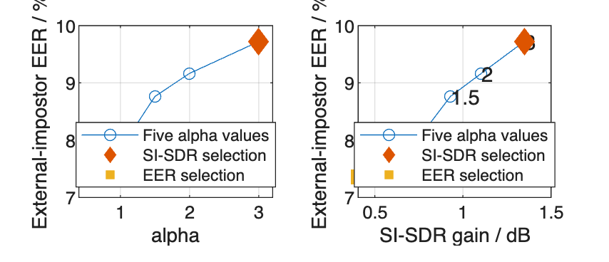

Table 37 and Figure 15: Test EER increases at each tested α step. Development EER also rises overall, with a small decrease between two intermediate settings. The EER-selected α = 0.5 is the smallest candidate in this experiment.

# 22. Enhancement Δcos and case classification

Enhancement Δcos is the change in cosine similarity between an utterance's embedding and its same-utterance clean-reference embedding: p_experiment_cases() applies the classification rules, and p_case_representative() selects the specified representative. p_show_case_spectrum() displays its spectra.

Δcos = cos(enhanced embedding, same-utterance clean embedding) − cos(noisy embedding, same-utterance clean embedding).

Positive Δcos means that enhancement moves the embedding closer to the clean-utterance reference; negative Δcos means it moves farther away. Combine this diagnostic with SI-SDR gain to classify the samples. Verification decisions use the separate enrollment reference.

Class A: SI-SDR gain > 1 dB and Δcos > 0.01. SI-SDR improves and the embedding moves closer to the same-utterance clean reference.

Class B: SI-SDR gain > 1 dB and Δcos < −0.01. SI-SDR improves but the embedding moves farther from the same-utterance clean reference.

Class C: |SI-SDR gain| ≤ 1 dB and Δcos > 0.01. SI-SDR changes little and the embedding moves closer to the same-utterance clean reference.

Other: Samples that meet none of these three definitions.

```matlab
assert(exist('experiment','var')==1 && exist('quality','var')==1 && exist('ctx','var')==1 && exist('main','var')==1,'Run Sections 1–20 in order first.');
[cases,caseCounts,representatives]=p_experiment_cases(experiment,quality,ctx.analysis);disp(caseCounts(ismember(caseCounts.Method,main(main~="Noisy")),:));disp(representatives(ismember(representatives.Method,main(main~="Noisy")),:));
```

```matlabTextOutput
        Method          Case      Count    Total    Percentage
    _______________    _______    _____    _____    __________

    "DeepFilterNet"    "A"          68      720       9.4444
    "DeepFilterNet"    "B"         464      720       64.444
    "DeepFilterNet"    "C"          18      720          2.5
    "DeepFilterNet"    "Other"     170      720       23.611
    "SS_a0p5"          "A"           0      720            0
    "SS_a0p5"          "B"          33      720       4.5833
    "SS_a0p5"          "C"          62      720       8.6111
    "SS_a0p5"          "Other"     625      720       86.806
    "SS_a1p5"          "A"           8      720       1.1111
    "SS_a1p5"          "B"         262      720       36.389
    "SS_a1p5"          "C"          40      720       5.5556
    "SS_a1p5"          "Other"     410      720       56.944
    "SS_a3p0"          "A"           9      720         1.25
    "SS_a3p0"          "B"         366      720       50.833
    "SS_a3p0"          "C"          33      720       4.5833
    "SS_a3p0"          "Other"     312      720       43.333

        Method          Case            ConditionID                         ClipID                     Distance
    _______________    _______    _______________________    _____________________________________    __________

    "DeepFilterNet"    "A"        "test_base_0232_snr_-5"    "test_base_0232_snr_-5_DeepFilterNet"        1.5294
    "DeepFilterNet"    "B"        "test_base_0218_snr_5"     "test_base_0218_snr_5_DeepFilterNet"        0.13096
    "DeepFilterNet"    "C"        "test_base_0397_snr_-5"    "test_base_0397_snr_-5_DeepFilterNet"       0.62192
    "DeepFilterNet"    "Other"    "test_base_0394_snr_10"    "test_base_0394_snr_10_DeepFilterNet"      0.090851
    "SS_a0p5"          "B"        "test_base_0245_snr_10"    "test_base_0245_snr_10_SS_a0p5"           0.0044154
    "SS_a0p5"          "C"        "test_base_0172_snr_10"    "test_base_0172_snr_10_SS_a0p5"           0.0072265
    "SS_a0p5"          "Other"    "test_base_0224_snr_0"     "test_base_0224_snr_0_SS_a0p5"           0.00033786
    "SS_a1p5"          "A"        "test_base_0237_snr_5"     "test_base_0237_snr_5_SS_a1p5"              0.13329
    "SS_a1p5"          "B"        "test_base_0359_snr_10"    "test_base_0359_snr_10_SS_a1p5"            0.004183
    "SS_a1p5"          "C"        "test_base_0352_snr_0"     "test_base_0352_snr_0_SS_a1p5"            0.0055997
    "SS_a1p5"          "Other"    "test_base_0407_snr_-5"    "test_base_0407_snr_-5_SS_a1p5"            0.033517
    "SS_a3p0"          "A"        "test_base_0391_snr_10"    "test_base_0391_snr_10_SS_a3p0"              0.5916
    "SS_a3p0"          "B"        "test_base_0383_snr_-5"    "test_base_0383_snr_-5_SS_a3p0"            0.033359
    "SS_a3p0"          "C"        "test_base_0262_snr_-5"    "test_base_0262_snr_-5_SS_a3p0"            0.033124
    "SS_a3p0"          "Other"    "test_base_0367_snr_0"     "test_base_0367_snr_0_SS_a3p0"            0.0095943
```

```matlab
writetable(representatives,fullfile(root,'results','case_representatives.csv'));
bCase=caseCounts(caseCounts.Method=="DeepFilterNet" & caseCounts.Case=="B",:);
fprintf('DeepFilterNet class B: %d/%d (%.1f%%), with SI-SDR gain above 1 dB and enhancement DeltaCos below -0.01.\n',bCase.Count,bCase.Total,bCase.Percentage);
```

```matlabTextOutput
DeepFilterNet class B: 464/720 (64.4%), with SI-SDR gain above 1 dB and enhancement DeltaCos below -0.01.
```

```matlab
% Verification transitions are counted separately from embedding-reference changes.
noisyScores=experiment.scores(:,:,experiment.methods=="Noisy",1);transitionRows=struct([]);
for k=1:numel(experiment.methods)
 processedScores=experiment.scores(:,:,k,1);
 for trialType=["genuine","external_impostor"]
  mask=experiment.genuine;if trialType=="external_impostor",mask=experiment.external;end
  before=noisyScores(mask)>=parameters.common_threshold;after=processedScores(mask)>=parameters.common_threshold;
  for a=[false,true]
   for b=[false,true]
    transitionRows=[transitionRows;struct('Method',experiment.methods(k),'TrialType',trialType,'NoisyAccepted',a,'ProcessedAccepted',b,'Count',sum(before==a & after==b),'Denominator',numel(before))];
   end
  end
 end
end
transitions=struct2table(transitionRows);writetable(transitions,fullfile(root,'results','verification_transitions.csv'));
disp(transitions(ismember(transitions.Method,main) & transitions.NoisyAccepted~=transitions.ProcessedAccepted,:));
```

```matlabTextOutput
        Method              TrialType         NoisyAccepted    ProcessedAccepted    Count    Denominator
    _______________    ___________________    _____________    _________________    _____    ___________

    "DeepFilterNet"    "genuine"                  false              true             15         720
    "DeepFilterNet"    "genuine"                  true               false            48         720
    "DeepFilterNet"    "external_impostor"        false              true            131        7200
    "DeepFilterNet"    "external_impostor"        true               false            53        7200
    "Noisy"            "genuine"                  false              true              0         720
    "Noisy"            "genuine"                  true               false             0         720
    "Noisy"            "external_impostor"        false              true              0        7200
    "Noisy"            "external_impostor"        true               false             0        7200
    "SS_a0p5"          "genuine"                  false              true              9         720
    "SS_a0p5"          "genuine"                  true               false            14         720
    "SS_a0p5"          "external_impostor"        false              true             94        7200
    "SS_a0p5"          "external_impostor"        true               false            45        7200
    "SS_a1p5"          "genuine"                  false              true             11         720
    "SS_a1p5"          "genuine"                  true               false            28         720
    "SS_a1p5"          "external_impostor"        false              true            144        7200
    "SS_a1p5"          "external_impostor"        true               false            48        7200
    "SS_a3p0"          "genuine"                  false              true             11         720
    "SS_a3p0"          "genuine"                  true               false            43         720
    "SS_a3p0"          "external_impostor"        false              true            193        7200
    "SS_a3p0"          "external_impostor"        true               false            55        7200
```

```matlab
writetable(cases,fullfile(root,'results','case_assignments.csv'));writetable(caseCounts,fullfile(root,'results','case_counts.csv'));
figure('Color','w');hold on;
for method=main(main~="Noisy")
 r=cases(cases.Method==method,:);scatter(r.SI_SDRGain_dB,r.DeltaCos,12,'DisplayName',method);
end
xline(ctx.analysis.case_thresholds.SI_SDR_gain_dB,'--','HandleVisibility','off');yline(ctx.analysis.case_thresholds.delta_cos_tolerance,'--','HandleVisibility','off');yline(-ctx.analysis.case_thresholds.delta_cos_tolerance,'--','HandleVisibility','off');
xlabel('SI-SDR gain / dB');ylabel('Enhancement DeltaCos');legend('Location','best','Interpreter','none');grid on;
```

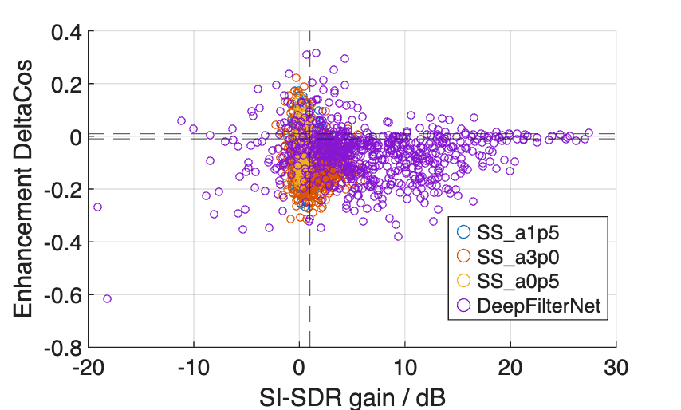

```matlab
p_show_case_spectrum(root,representatives,ctx.parameters.cfg,ctx.language);
```

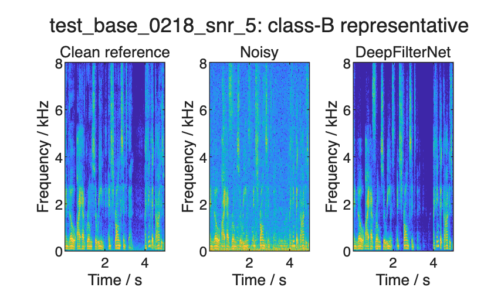

Tables 38–40 list case counts, representatives and verification transitions. Figure 16 shows the metric combinations; Figure 17 shows the DeepFilterNet class-B representative. DeepFilterNet has 464/720 mixtures (64.4%) in class B. Mean SI-SDR gains for percentile subtraction are approximately 0.4–1.3 dB, close to the 1 dB classification threshold; many samples meet none of A/B/C and fall in Other. Other is not missing data.

# 23. Speech preservation, noise estimation and frequency bands

Compare noise reduction, retained speech energy and enhancement Δcos for traditional methods, then plot bandwise retention for 0–1, 1–3 and 3–8 kHz. The scatterplots describe the distribution; no correlation coefficient or causal effect is estimated here.

```matlab
assert(exist('cases','var')==1 && exist('quality','var')==1 && exist('root','var')==1,'Run Sections 1–22 in order first.');
decomposition=quality(quality.ParticipantRole=="target" & isfinite(quality.SpeechRetained_pct),:);
disp(groupsummary(decomposition,'Method','mean',{'NoiseReduction_dB','SpeechRetained_pct','DecompositionRelativeError'}));
```

```matlabTextOutput
       Method        GroupCount    mean_NoiseReduction_dB    mean_SpeechRetained_pct    mean_DecompositionRelativeError
    _____________    __________    ______________________    _______________________    _______________________________

    "Noisy"             720             -1.3486e-14                     100                       1.9466e-16
    "SS_a0p5"           720                 0.71451                  94.656                       1.9265e-16
    "SS_a1p0"           720                  1.2664                  91.195                       1.9068e-16
    "SS_a1p5"           720                  1.7376                  88.404                       1.8964e-16
    "SS_a2p0"           720                  2.1523                   86.03                       1.8887e-16
    "SS_a3p0"           720                  2.8628                    82.1                       1.8831e-16
    "Tracking_SS"       720                  1.9049                  90.381                       1.9645e-16
    "VAD_SS"            720                  4.0581                  67.255                        1.902e-16
```

```matlab
noiseDiagnosticsAll=readtable(fullfile(root,'dsp','noise_estimator_diagnostics.csv'),'Delimiter',',','ReadVariableNames',true,'TextType','string');
disp(groupsummary(noiseDiagnosticsAll(noiseDiagnosticsAll.ParticipantRole=="target",:),'NoiseClass','mean', ...
 {'InitEnergyActivityRatio','VADSelectedEnergyActivityRatio','PercentileSelectedEnergyActivityRatio','VADNoisePSDTotalBias_dB','PercentileNoisePSDTotalBias_dB','TrackingNoisePSDTotalBias_dB'}));
```

```matlabTextOutput
      NoiseClass       GroupCount    mean_InitEnergyActivityRatio    mean_VADSelectedEnergyActivityRatio    mean_PercentileSelectedEnergyActivityRatio    mean_VADNoisePSDTotalBias_dB    mean_PercentileNoisePSDTotalBias_dB    mean_TrackingNoisePSDTotalBias_dB
    _______________    __________    ____________________________    ___________________________________    __________________________________________    ____________________________    ___________________________________    _________________________________

    "Babble"              240                  0.84583                             0.74434                                   0.61284                                 1.9779                             -3.9898                               -6.0791
    "HighVariation"       240                  0.84583                             0.76132                                   0.61274                                  2.069                             -4.1667                               -3.2669
    "LowVariation"        240                  0.84583                             0.76532                                   0.58995                                 2.0887                             -3.7887                               -3.0669
```

```matlab
bandRetention=readtable(fullfile(root,'dsp','band_speech_retention.csv'),'Delimiter',',','ReadVariableNames',true,'TextType','string');
figure('Color','w','Position',[100 100 1100 450]);tiledlayout(1,3);
for bi=1:3
 nexttile;hold on;
 for method=["SS_a1p5","VAD_SS","Tracking_SS"]
  rr=bandRetention(bandRetention.BandLow_Hz==ctx.analysis.frequency_bands_Hz(bi,1) & bandRetention.Method==method,:);
  cc=cases(cases.Method==method,:);[ok,ix]=ismember(rr.ConditionID,cc.ConditionID);assert(all(ok));
  scatter(rr.SpeechRetained_pct,cc.DeltaCos(ix),10,'DisplayName',method);
 end
 xlabel('Bandwise retained speech energy / %');ylabel('Enhancement DeltaCos');title(sprintf('%d–%d Hz',ctx.analysis.frequency_bands_Hz(bi,1),ctx.analysis.frequency_bands_Hz(bi,2)));grid on;
end
legend('Location','best','Interpreter','none');
```

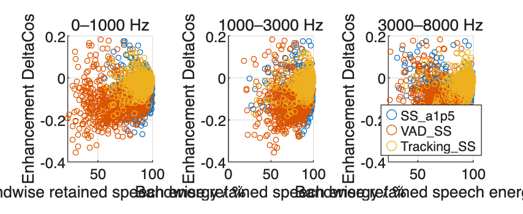

Tables 41 and 42 and Figure 18: VAD_SS shows lower speech-energy retention and more negative Δcos than Tracking_SS on many test mixtures, although their distributions overlap. Activity ratios use clean-speech energy. Speech detected during VAD initialization may raise its noise estimate. The effect on verification remains to be tested separately.

# 24. Intervals, alternative enrollment, source omission and band interventions

Estimate 95% confidence intervals for method differences using 20,000 bootstrap resamples. Resample target and unenrolled speakers separately within sex, retaining all utterances and noise conditions for each sampled speaker. All methods use the same draws. p_experiment_bootstrap() estimates the paired intervals. p_experiment_leave_source() recalculates the comparisons after each source omission, using p_leave_source_weights() to retain the planned weighting.

The primary analysis fixes the 20 enrollment references. In a secondary check, external-impostor comparisons with each enrollment reference are additionally counted according to how often that enrolled speaker is sampled.

Replace the primary enrollment recordings with the reserved alternatives, then omit each noise source in turn and recalculate the results. After an omission, retain equal weights for the three categories, four SNR levels and remaining sources within each category.

```matlab
assert(exist('resultSummary','var')==1 && exist('experiment','var')==1 && exist('parameters','var')==1 && exist('ctx','var')==1 && exist('main','var')==1,'Run Sections 1–19 in order first.');
disp(resultSummary(resultSummary.ReferenceSet=="enrollment_backup" & ismember(resultSummary.Method,main),{'Method','ExternalEER_pct','CommonThresholdBER_pct'}));
```

```matlabTextOutput
        Method         ExternalEER_pct    CommonThresholdBER_pct
    _______________    _______________    ______________________

    "DeepFilterNet"        8.9028                 8.3472
    "Noisy"                7.2222                 6.4653
    "SS_a0p5"              8.3333                 7.3681
    "SS_a1p5"              9.0278                 8.5972
    "SS_a3p0"              10.694                 9.3125
```

```matlab
bootstrapTimer=tic;
[comparisons,bootstrapDraws]=p_experiment_bootstrap(experiment,parameters,ctx.analysis);disp(comparisons);
```

```matlabTextOutput
          Comparison           Endpoint    SynchronousRegistration    Difference_pp    Lower95_pp    Upper95_pp    Repetitions      Seed
    _______________________    ________    _______________________    _____________    __________    __________    ___________    _________

    "SS_a1p5 - Noisy"           "EER"               false                 1.6806           0.25         3.1944        20000       5.308e+05
    "SS_a1p5 - Noisy"           "BER"               false                 1.8472        0.52083              3        20000       5.308e+05
    "DeepFilterNet - Noisy"     "EER"               false                 1.9444        0.45799         3.6111        20000       5.308e+05
    "DeepFilterNet - Noisy"     "BER"               false                 2.8333         1.1528         4.5625        20000       5.308e+05
    "SS_a0p5 - SS_a1p5"         "EER"               false                -1.4028        -2.2222       -0.70833        20000       5.308e+05
    "SS_a0p5 - SS_a1p5"         "BER"               false                -1.1597        -1.8264           -0.5        20000       5.308e+05
    "SS_a0p5 - SS_a3p0"         "EER"               false                -2.3611        -3.6111        -1.3472        20000       5.308e+05
    "SS_a0p5 - SS_a3p0"         "BER"               false                -2.4931        -3.4375        -1.5417        20000       5.308e+05
    "SS_a1p5 - Noisy"           "EER"               true                  1.6806        0.55556         2.8333        20000       5.308e+05
    "SS_a1p5 - Noisy"           "BER"               true                  1.8472        0.83333         2.8611        20000       5.308e+05
    "DeepFilterNet - Noisy"     "EER"               true                  1.9444        0.69444         3.4722        20000       5.308e+05
    "DeepFilterNet - Noisy"     "BER"               true                  2.8333         1.5345         4.3125        20000       5.308e+05
    "SS_a0p5 - SS_a1p5"         "EER"               true                 -1.4028        -2.2222       -0.51389        20000       5.308e+05
    "SS_a0p5 - SS_a1p5"         "BER"               true                 -1.1597        -1.8194           -0.5        20000       5.308e+05
    "SS_a0p5 - SS_a3p0"         "EER"               true                 -2.3611        -3.6111        -1.3194        20000       5.308e+05
    "SS_a0p5 - SS_a3p0"         "BER"               true                 -2.4931        -3.3194        -1.6806        20000       5.308e+05
```

```matlab
writetable(comparisons,fullfile(root,'results','primary_comparisons.csv'));
save(fullfile(root,'results','matlab_bootstrap_draws.mat'),'bootstrapDraws','-v7');
leaveSource=p_experiment_leave_source(experiment,parameters);disp(p_leave_source_summary(leaveSource,parameters));
```

```matlabTextOutput
          Comparison           Endpoint    MinimumDifference_pp    MaximumDifference_pp    Positive    Negative    NearZero
    _______________________    ________    ____________________    ____________________    ________    ________    ________

    "SS_a1p5 - Noisy"           "EER"             1.0278                   2.4306             9           0           0
    "SS_a1p5 - Noisy"           "BER"             1.5313                   2.2292             9           0           0
    "DeepFilterNet - Noisy"     "EER"             1.4444                      2.5             9           0           0
    "DeepFilterNet - Noisy"     "BER"             2.2951                   3.4618             9           0           0
    "SS_a0p5 - SS_a1p5"         "EER"            -1.6667                  -1.3889             0           9           0
    "SS_a0p5 - SS_a1p5"         "BER"            -1.4132                 -0.93403             0           9           0
    "SS_a0p5 - SS_a3p0"         "EER"             -3.125                  -2.0833             0           9           0
    "SS_a0p5 - SS_a3p0"         "BER"            -2.9028                  -2.2361             0           9           0
```

```matlab
writetable(leaveSource,fullfile(root,'results','leave_source_comparisons.csv'));
```

Tables 43–45: The four primary EER-difference intervals are [0.25, 3.19], [0.46, 3.61], [−2.22, −0.71] and [−3.61, −1.35] percentage points. Each excludes zero, and the BER intervals show the same pattern. Leave-one-source-out checks preserve the directions of all four comparisons. These intervals use fixed noise sources and no multiple-comparison adjustment.

```matlab
assert(exist('root','var')==1 && exist('ctx','var')==1,'Run Sections 1–18 in order first.');
p_run_python(ctx,'prepare_band_interventions.py',root);
bandInputs=readtable(fullfile(root,'band_intervention','clip_index.csv'),'Delimiter',',','ReadVariableNames',true,'TextType','string');
disp(groupsummary(bandInputs,{'Kind','Level_dB'},'mean','EnergyRatio'));
```

```matlabTextOutput
             Kind              Level_dB    GroupCount    mean_EnergyRatio
    _______________________    ________    __________    ________________

    "clean"                        0           60                  1
    "fixed"                        3          180            0.83367
    "fixed"                        6          180            0.75022
    "fixed"                       12          180            0.68729
    "fixed_level_control"          3          180            0.83367
    "fixed_level_control"          6          180            0.75022
    "fixed_level_control"         12          180            0.68729
    "matched"                      3          180            0.97737
    "matched"                      6          180              0.966
    "matched"                     12          180            0.95739
    "matched_level_control"        3           60            0.97737
    "matched_level_control"        6           60              0.966
    "matched_level_control"       12           60            0.95739
```

```matlab
p_run_python(ctx,'embed_band_interventions.py',root);
p_run_python(ctx,'analyze_band_interventions.py',root);
bandSummary=readtable(fullfile(root,'results','band_intervention_summary.csv'),'Delimiter',',','ReadVariableNames',true,'TextType','string');disp(bandSummary(:,{'Kind','Level_dB','BandLow_Hz','BandHigh_Hz','MeanDeltaCos','MeanLevelControlDeltaCos','MeanEffectiveAttenuation_dB'}));
```

```matlabTextOutput
      Kind       Level_dB    BandLow_Hz    BandHigh_Hz    MeanDeltaCos    MeanLevelControlDeltaCos    MeanEffectiveAttenuation_dB
    _________    ________    __________    ___________    ____________    ________________________    ___________________________

    "fixed"          3             0          1000        -0.00064877           -2.3162e-10                           3
    "fixed"          3          1000          3000        -0.00045032           -1.7031e-10                           3
    "fixed"          3          3000          8000        -0.00080133           -1.8169e-10                           3
    "fixed"          6             0          1000         -0.0020593           -3.4139e-10                           6
    "fixed"          6          1000          3000         -0.0020395           -1.6433e-10                           6
    "fixed"          6          3000          8000         -0.0035732           -1.8319e-10                           6
    "fixed"         12             0          1000         -0.0052255            -6.834e-10                          12
    "fixed"         12          1000          3000          -0.010349           -1.7299e-10                          12
    "fixed"         12          3000          8000          -0.016879           -1.7942e-10                          12
    "matched"        3             0          1000         -2.171e-06           -1.7163e-10                     0.15556
    "matched"        3          1000          3000         -0.0001014           -1.7163e-10                      1.2065
    "matched"        3          3000          8000         -0.0007681           -1.7163e-10                      2.8909
    "matched"        6             0          1000        -4.5706e-06           -1.6697e-10                     0.24062
    "matched"        6          1000          3000        -0.00040799           -1.6697e-10                       2.176
    "matched"        6          3000          8000         -0.0034108           -1.6697e-10                       5.735
    "matched"       12             0          1000        -7.0822e-06           -1.6667e-10                     0.30875
    "matched"       12          1000          3000          -0.001673           -1.6667e-10                      3.6233
    "matched"       12          3000          8000          -0.015865           -1.6667e-10                      11.281
```

```matlab
figure('Color','w','Position',[100 100 1150 600]);bandLayout=tiledlayout(1,2,'TileSpacing','compact','Padding','compact');
for intervention=["fixed","matched"]
 nexttile;hold on;
 colors=lines(3);
 for bi=0:2
  rr=sortrows(bandSummary(bandSummary.Kind==intervention & bandSummary.BandIndex==bi,:),'Level_dB');
  label=sprintf('%d–%d Hz',rr.BandLow_Hz(1),rr.BandHigh_Hz(1));
  plot(rr.Level_dB,rr.MeanDeltaCos,'-o','Color',colors(bi+1,:),'DisplayName',label);
  plot(rr.Level_dB,rr.MeanLevelControlDeltaCos,'--','Color',colors(bi+1,:),'DisplayName',label+" level control");
 end
 xlabel('Nominal attenuation / dB');ylabel('DeltaCos to clean');if intervention=="fixed",title('Fixed attenuation');else,title('Energy-matched attenuation');end;grid on;
end
bandLegend=legend('Interpreter','none','NumColumns',3,'FontSize',9);bandLegend.Layout.Tile='south';
```

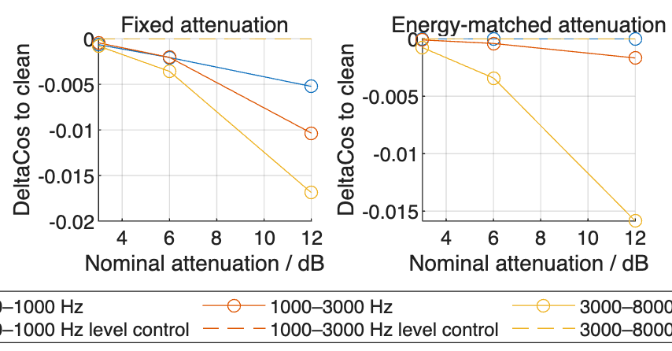

Tables 46 and 47 and Figure 19: Clean-speech band interventions include fixed attenuation, energy-matched attenuation and their corresponding whole-signal level controls. The two panels show each intervention with its controls. Nominal dB levels in the energy-matched design do not imply equal effective band attenuation. Here Δcos is relative to unprocessed clean speech, whereas enhancement Δcos is relative to Noisy. Their magnitudes cannot be directly compared or used to explain enhancement-related verification errors.

# 25. Supplementary clean-query verification

This supplementary experiment aims to establish a clean-speech verification baseline and examine whether speech enhancement affects speaker verification performance even without added noise.

```matlab
if exist('ctx','var')==1 && p_clean_query_context_ready(ctx)
 cleanQueryRoot=p_run_clean_query(ctx);
```

```matlabTextOutput
CLEAN_SS_COMPLETE: 90 unique queries, original alpha 1.5 and beta 0.02
MATLAB_METRICS_VERIFIED maximum difference 0 percentage points
```

```matlab
else
 projectRoot=local_project_root(mfilename('fullpath'));
 cleanQueryRoot=fullfile(projectRoot,'results','tables','clean_query');
end
p_inspect_clean_query(cleanQueryRoot);
```

```matlabTextOutput
90 unique queries: 60 target and 30 external; 20 unchanged primary enrollment references.
60 genuine / 600 external trials per clean condition. Fixed threshold 0.270078811669524.
           Method            EER_pct    FAR_pct    FRR_pct    BER_pct    FalseRejects    FalseAccepts
    _____________________    _______    _______    _______    _______    ____________    ____________

    "Clean"                        0      2.5         0        1.25           0               15
    "Clean_SS_a1p5"          0.16667        4         0           2           0               24
    "Clean_DeepFilterNet"          0        3         0         1.5           0               18

Interface controls, reported separately:
           Method            EER_pct    FAR_pct    FRR_pct    BER_pct
    _____________________    _______    _______    _______    _______

    "Clean_Resample_only"       0       2.8333        0       1.4167
    "Clean_Adapter"             0       2.8333        0       1.4167

Main Noisy run (different trial counts; descriptive context):
        Method         EER_pct    FAR_pct    FRR_pct    BER_pct    GenuineTrials    ExternalTrials    FalseRejects    FalseAccepts    Threshold
    _______________    _______    _______    _______    _______    _____________    ______________    ____________    ____________    _________

    "Noisy"            7.0833     1.8333     9.8611     5.8472          720              7200              71             132          0.27008
    "SS_a1p5"          8.7639     3.1667     12.222     7.6944          720              7200              88             228          0.27008
    "DeepFilterNet"    9.0278     2.9167     14.444     8.6806          720              7200             104             210          0.27008
```

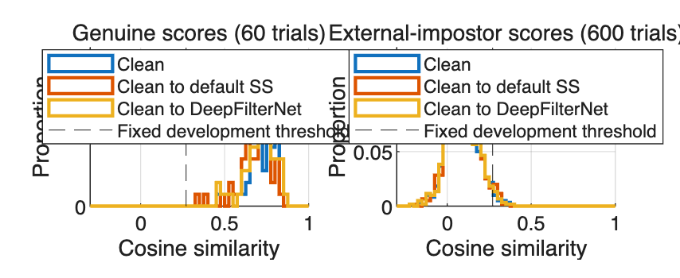

```matlabTextOutput
EER scans thresholds; FAR/FRR/BER use the unchanged development threshold.
Zero observed EER does not imply zero error at that fixed threshold or perfect generalisation.
```

Clean speech achieves an EER of 0%, compared with 0.167% after default spectral subtraction and 0% after DeepFilterNet. However, fixed-threshold BER increases from 1.25% to 2.00% and 1.50%, respectively. These findings show that speech enhancement can affect speaker verification performance even when no noise is added.

# 26. Summary of findings

The first summary table below compares the main systems; the second lists SNR-specific DeepFilterNet-minus-Noisy differences. SI-SDR, STOI and enhancement Δcos means use 720 enrolled-speaker test mixtures; verification rates use genuine and external-impostor trials.

```matlab
assert(exist('primary','var')==1 && exist('main','var')==1 && exist('conditional','var')==1 && exist('caseCounts','var')==1,'Run Sections 1–24 in order first.');
[ok,ix]=ismember(main,primary.Method);assert(all(ok));
disp(primary(ix,{'Method','TargetSI_SDRGain_dB','TargetSTOIChange','ExternalEER_pct','CommonThresholdBER_pct','CommonThresholdFAR_pct','CommonThresholdFRR_pct','MeanDeltaCos'}));
```

```matlabTextOutput
        Method         TargetSI_SDRGain_dB    TargetSTOIChange    ExternalEER_pct    CommonThresholdBER_pct    CommonThresholdFAR_pct    CommonThresholdFRR_pct    MeanDeltaCos
    _______________    ___________________    ________________    _______________    ______________________    ______________________    ______________________    ____________

    "Noisy"                7.3387e-17           -4.3175e-18           7.0833                 5.8472                    1.8333                    9.8611                     0
    "SS_a1p5"                  0.9293             -0.003706           8.7639                 7.6944                    3.1667                    12.222             -0.075473
    "SS_a3p0"                  1.3475             -0.011181           9.7222                 9.0278                      3.75                    14.306              -0.10488
    "SS_a0p5"                 0.40582            0.00010937           7.3611                 6.5347                    2.5139                    10.556              -0.04116
    "DeepFilterNet"             6.258              0.029086           9.0278                 8.6806                    2.9167                    14.444              -0.06468
```

```matlab
 base=primary(primary.Method=="Noisy",:);
 for method=["SS_a1p5","DeepFilterNet"]
  r=primary(primary.Method==method,:);
  fprintf('%s: mean SI-SDR gain %.3f dB, STOI change %+.4f; EER %.3f%% versus %.3f%% for Noisy.\n',method,r.TargetSI_SDRGain_dB,r.TargetSTOIChange,r.ExternalEER_pct,base.ExternalEER_pct);
```

```matlabTextOutput
SS_a1p5: mean SI-SDR gain 0.929 dB, STOI change -0.0037; EER 8.764% versus 7.083% for Noisy.
```

```matlabTextOutput
DeepFilterNet: mean SI-SDR gain 6.258 dB, STOI change +0.0291; EER 9.028% versus 7.083% for Noisy.
```

```matlab
  fprintf('Relative to Noisy: FAR change %+.3f percentage points; FRR change %+.3f points.\n',r.CommonThresholdFAR_pct-base.CommonThresholdFAR_pct,r.CommonThresholdFRR_pct-base.CommonThresholdFRR_pct);
```

```matlabTextOutput
Relative to Noisy: FAR change +1.333 percentage points; FRR change +2.361 points.
```

```matlabTextOutput
Relative to Noisy: FAR change +1.083 percentage points; FRR change +4.583 points.
```

```matlab
 end
 r=conditional(conditional.Method=="DeepFilterNet" & conditional.NoiseClass=="ALL",:);
 n=conditional(conditional.Method=="Noisy" & conditional.NoiseClass=="ALL",:);r=sortrows(r,'InputSNR_dB');n=sortrows(n,'InputSNR_dB');
 disp(table(r.InputSNR_dB,r.EER_pct-n.EER_pct,'VariableNames',{'SNR_dB','DFN_minus_Noisy_EER_pp'}));
```

```matlabTextOutput
    SNR_dB    DFN_minus_Noisy_EER_pp
    ______    ______________________

      -5              2.2222
       0                 3.5
       5              2.7222
      10             0.66667
```

```matlab
save(fullfile(ctx.runRoot,'stepwise_completed.mat'),'parameters','root','devRoot','selectionTable','resultSummary','caseCounts','-v7');
```

For these models and materials, DeepFilterNet improves SI-SDR and STOI, while default percentile subtraction improves SI-SDR but slightly reduces STOI; both have higher verification EER and BER than Noisy. Test EER rises across the five α values. This subtraction finding is specific to the percentile estimator: Tracking-SS has EER 7.64%, closer to Noisy’s 7.08% than default percentile subtraction’s 8.76%.

DeepFilterNet places 64.4% of mixtures in class B, with improved SI-SDR but reduced clean-reference similarity. The verification test uses utterances from 20 enrolled and 10 unenrolled speakers, with nine noise sources; intervals are not adjusted for multiple comparisons. Band analyses do not establish the cause of poorer verification.

The supplementary clean-query experiment shows that enhancement can also affect verification performance without added noise. Although DeepFilterNet maintains an EER of 0%, fixed-threshold BER increases from 1.25% to 1.50%. Default spectral subtraction also increases EER from 0% to 0.167% and BER from 1.25% to 2.00%.

# Appendix — Local MATLAB Functions

The supporting MATLAB functions below are grouped by their role in the experiment.

```matlab
% A. Project Setup and Configuration

% Locate project files, read configuration and prepare dataset directories.

function root=local_project_root(scriptPath)
candidates=string({fileparts(scriptPath),pwd,getenv('ELEC5305_DISPLAY_ROOT'), ...
 fileparts(which('final_project.mlx')),fileparts(which('Final_Project.mlx')),fileparts(which('Final_Project_source.m')),fileparts(which('Final_Project_EN.mlx')),fileparts(which('final_project_merged.mlx'))});
try
 active=matlab.desktop.editor.getActiveFilename;
 if ~isempty(active),candidates(end+1)=string(fileparts(active));end
 documents=matlab.desktop.editor.getAll;
 for j=1:numel(documents)
  [folder,name]=fileparts(documents(j).Filename);
  if ismember(string(name),["final_project","Final_Project","Final_Project_EN","final_project_merged"]),candidates(end+1)=string(folder);end
 end
catch
end
for candidate=candidates
 if isfile(fullfile(candidate,'protocol','test_config.json'))
  root=char(candidate);return;
 end
end
error('Set the MATLAB current folder to the project directory and run Section 1.');
end
function ctx=local_context(root,language)
assert(exist('hann','file')>0,'Signal Processing Toolbox is required.');
assert(exist('stoi','file')>0,'Audio Toolbox is required.');
runtimePath=fullfile(root,'runtime.local.json');
assert(isfile(runtimePath),'ELEC5305:MissingRuntimeConfig', ...
 'Missing local runtime configuration. Copy runtime.local.example.json to runtime.local.json and set python, materials_root and tools_root for this computer. Keep runtime.local.json private.');
settings=jsondecode(fileread(runtimePath));
assert(isstruct(settings) && isscalar(settings) && all(isfield(settings,{'python','materials_root','tools_root'})), ...
 'runtime.local.json must contain python, materials_root and tools_root.');
ctx=struct('projectRoot',root,'language',language);
ctx.python=local_setting(settings,'python','ELEC5305_PYTHON','python3',root);
ctx.materialsRoot=local_setting(settings,'materials_root','ELEC5305_MATERIALS',fullfile('data','materials'),root);
assert(isfolder(ctx.materialsRoot),'Set materials_root in runtime.local.json to the local material_audit/noise_audit parent.');
ctx.toolsRoot=local_setting(settings,'tools_root','ELEC5305_TOOLS','tools',root);
assert(isfolder(ctx.toolsRoot),'Set tools_root in runtime.local.json to the local DeepFilterNet/ECAPA/VOICEBOX tools directory.');
ctx.parameters=jsondecode(fileread(fullfile(root,'protocol','test_config.json')));
ctx.analysis=jsondecode(fileread(fullfile(root,'protocol','analysis_rules.json')));
parent=fullfile(root,'runs');if ~isfolder(parent),mkdir(parent);end
[~,id]=fileparts(tempname(parent));ctx.runRoot=fullfile(parent,['experiment_' char(language) '_' id]);mkdir(ctx.runRoot);
end
function value=local_setting(settings,key,env,fallback,root)
value=getenv(env);if isempty(value) && isfield(settings,key),value=char(settings.(key));end
if isempty(value),value=fallback;end
if strcmp(key,'python') && ~contains(value,filesep),return;end
if ispc,absolute=~isempty(regexp(value,'^[A-Za-z]:[\\/]|^\\\\','once'));else,absolute=startsWith(value,'/');end
if ~absolute,value=fullfile(root,value);end
end
function path=local_original_speech(ctx,row)
folder=fullfile(ctx.runRoot,'original_speech');mkdir(folder);
path=fullfile(folder,char(row.UtteranceID+".flac"));
p_run_python(ctx,'experiment_io.py','extract', ...
 '--archive',fullfile(ctx.materialsRoot,'material_audit',char(row.SpeechSubset+".tar.gz")), ...
 '--member',char(row.SpeechArchiveMember),'--sha256',char(row.SpeechSourceSHA256),'--output',path);
end
function path=local_noise_path(ctx,noiseClass,sourceID)
if string(noiseClass)=="Babble"
 path=fullfile(ctx.materialsRoot,'noise_audit','babble',char(sourceID+".wav"));
else
 path=fullfile(ctx.materialsRoot,'noise_audit','analysis16k',char(sourceID+"_ch01_16k.wav"));
end
assert(isfile(path),'Noise file not found: %s',path);
end

% Source: src/matlab/p_initialize_dataset.m

function root=p_initialize_dataset(ctx,split)
root=fullfile(ctx.runRoot,char(split));
p_run_python(ctx,'experiment_io.py','initialize','--root',root,'--project',ctx.projectRoot,'--split',char(split));
end

% B. STFT and Speech Enhancement

% Analyse and reconstruct waveforms, estimate noise and apply spectral subtraction.

% Source: src/matlab/p_stft.m

function [Y, meta] = p_stft(x, cfg)
% Padded, one-sided STFT. Estimators must exclude synthetic boundary frames.
x = x(:); L = cfg.winLength; H = cfg.hopSize; F = cfg.nfft;
assert(F >= L && mod(F,2)==0, 'Use an even FFT length >= window length.');
w = hann(L, 'periodic');
xp = [zeros(L,1); x; zeros(L + mod(-length(x),H),1)];
starts = 1:H:(length(xp)-L+1);
Y = zeros(F/2+1, numel(starts));
for m = 1:numel(starts)
    idx = starts(m):starts(m)+L-1;
    spec = fft(xp(idx).*w, F);
    Y(:,m) = spec(1:F/2+1);
end
meta = struct('window',w,'starts',starts,'paddedLength',length(xp), ...
    'originalLength',length(x),'padLeft',L,'nfft',F);
meta.fullFrames = starts >= L+1 & starts+L-1 <= L+length(x);
assert(any(meta.fullFrames), 'Recording must contain at least one full frame.');
end

% Source: src/matlab/p_istft.m

function x = p_istft(Y, meta)
% Weighted overlap-add, followed by trimming to the original samples.
L = numel(meta.window); w = meta.window;
xp = zeros(meta.paddedLength,1); weights = xp;
assert(size(Y,2)==numel(meta.starts), 'STFT frame count mismatch.');
for m = 1:size(Y,2)
    spec = [Y(:,m); conj(Y(end-1:-1:2,m))];
    frame = real(ifft(spec,meta.nfft));
    idx = meta.starts(m):meta.starts(m)+L-1;
    xp(idx) = xp(idx) + frame(1:L).*w;
    weights(idx) = weights(idx) + w.^2;
end
keep = meta.padLeft+(1:meta.originalLength);
assert(all(weights(keep)>1e-8), 'Original samples lack reconstruction support.');
x = xp(keep)./weights(keep);
end

% Source: src/matlab/p_noise_psd.m

function [P, info] = p_noise_psd(Y, meta, fs, cfg, method)
% Only noisy STFT data enter this estimator; no clean/noise references.
power = abs(Y).^2; valid = find(meta.fullFrames);
% Unweighted spectral frame level for the simplified VAD.
level = sqrt(mean(power,1));
selected = false(1,size(Y,2)); speech = false(1,size(Y,2));
floorTrack = nan(1,size(Y,2));
switch method
    case 'percentile'
        threshold = prctile(level(valid),cfg.noisePercentile);
        selected(valid) = level(valid)<=threshold;
        p = mean(power(:,selected),2);
        P = repmat(p,1,size(Y,2));
    case 'vad'
        % Assumption: the first cfg.initNoiseSeconds of complete frames are
        % noise-dominated. Test this assumption using references only later.
        dt = cfg.hopSize/fs;
        assert(dt<cfg.floorFallSeconds,'Tutorial 6 requires hop time < 0.04 s.');
        nInit = min(numel(valid),max(1,ceil(cfg.initNoiseSeconds/dt)));
        init = valid(1:nInit);
        p = mean(power(:,init),2);
        noiseFloor = max(median(level(init)),sqrt(eps));
        state = false; smooth = exp(-dt/cfg.psdTimeConstant);
        P = zeros(size(power));
        for m = 1:size(Y,2)
            if meta.fullFrames(m)
                if m <= init(end)
                    state = false;
                elseif level(m)>cfg.vadSpeechRatio*noiseFloor
                    state = true;
                elseif level(m)<cfg.vadNoiseRatio*noiseFloor
                    state = false;
                end % Between thresholds, retain the previous state.
                speech(m) = state; selected(m) = ~state;
                if m>init(end) && ~state
                    p = smooth*p + (1-smooth)*power(:,m);
                end
                if level(m)>noiseFloor
                    tau = cfg.floorRiseSeconds;
                else
                    tau = cfg.floorFallSeconds;
                end
                % Tutorial 6 Q5: slow rise dt/10; fast fall dt/0.04.
                noiseFloor = max(noiseFloor + ...
                    (level(m)-noiseFloor)*(dt/tau),sqrt(eps));
            end
            P(:,m) = p; floorTrack(m) = noiseFloor;
        end
    otherwise
        error('Unknown estimator: %s',method);
end
info = struct('selected',selected,'speech',speech, ...
    'level',level,'noiseFloor',floorTrack);
end

% Source: src/matlab/p_spectral_gain.m

function G = p_spectral_gain(Y, Pnoise, cfg)
% Identical power-subtraction rule for every PSD-estimator comparison.
Py = abs(Y).^2;
Pclean = max(Py-cfg.alpha*Pnoise,cfg.beta*Py);
G = sqrt(Pclean./max(Py,realmin));
% A zero-energy bin may use any gain; the floor keeps the rule continuous.
G(Py==0) = sqrt(cfg.beta);
assert(all(isfinite(G(:))) && all(G(:)>=0) && all(G(:)<=1+1e-12));
end

% Source: src/matlab/run_test_dsp.m

function run_test_dsp(root)
% Supporting MATLAB functions are local to this Live Script.
vb=dir(fullfile(root,'tools','voicebox_source','sap-voicebox-*'));addpath(fullfile(vb(1).folder,vb(1).name,'voicebox'));
conf=jsondecode(fileread(fullfile(root,'test_config.json')));cfg=conf.cfg;fs=conf.sample_rate;
A=readtable(fullfile(root,'inputs','test_conditions.csv'),'Delimiter',',','ReadVariableNames',true,'TextType','string');
C=readtable(fullfile(root,'inputs','clean_index.csv'),'Delimiter',',','ReadVariableNames',true,'TextType','string');
assert(height(A)==conf.expected_mixtures && all(A.Split==string(conf.split)));assert(all(ismember(C.RecordingRole,["enrollment_primary","enrollment_backup",string(conf.split)])));
out=fullfile(root,'dsp');audio=fullfile(out,'audio16k');if ~isfolder(audio),mkdir(audio);end
methods=["Noisy","SS_a0p5","SS_a1p0","SS_a1p5","SS_a2p0","SS_a3p0","VAD_SS","Tracking_SS"];
alphas=conf.candidate_alphas(:)';assert(isequal(alphas,[.5 1 1.5 2 3]));
bandrows=struct([]);clips=struct([]);metrics=struct([]);diagnostics=struct([]);reconstructionMax=0;decompMax=0;exportsMax=0;
for ci=1:height(C)
 [x,sr]=audioread(C.CleanPath(ci));assert(sr==fs && numel(x)==80000);
 % The same policy gives gain=0.5 for peak-normalized enrollment/clean speech.
 gain=conf.export_headroom/max(1,max(abs(x)));id="clean_"+C.UtteranceID(ci);path=fullfile(audio,id+".wav");audiowrite(path,gain*x,fs,'BitsPerSample',24);
 row=struct('ClipID',id,'ConditionID',"",'SpeakerID',C.SpeakerID(ci),'UtteranceID',C.UtteranceID(ci),'ParticipantRole',C.ParticipantRole(ci),'RecordingRole',C.RecordingRole(ci),'Method',"Clean",'NoiseClass',"",'NoiseSourceID',"",'InputSNR_dB',NaN,'Path',string(path),'ExportGain',gain);
 clips=[clips;row]; %#ok<AGROW>
end
for ai=1:height(A)
 r=A(ai,:);[x,sr]=audioread(r.CleanPath);[d,srd]=audioread(r.NoiseComponentPath);assert(sr==fs && srd==fs);y=x+d;
 [Y,meta]=p_stft(y,cfg);X=p_stft(x,cfg);D=p_stft(d,cfg);
 re=norm(p_istft(Y,meta)-y)/norm(y);reconstructionMax=max(reconstructionMax,re);assert(re<1e-12);
 [P,pi]=p_noise_psd(Y,meta,fs,cfg,'percentile');[PV,vi]=p_noise_psd(Y,meta,fs,cfg,'vad');
 valid=find(meta.fullFrames);PTrackValid=v_estnoisem(abs(Y(:,valid).').^2,cfg.hopSize/fs).';
 PT=zeros(size(Y));PT(:,valid)=PTrackValid;PT(:,1:valid(1)-1)=repmat(PT(:,valid(1)),1,valid(1)-1);PT(:,valid(end)+1:end)=repmat(PT(:,valid(end)),1,size(Y,2)-valid(end));
 assert(all(isfinite(PT(:))) && all(PT(:)>=0));
 gains=cell(1,numel(methods));gains{1}=ones(size(Y));
 for k=1:5,acfg=cfg;acfg.alpha=alphas(k);gains{k+1}=p_spectral_gain(Y,P,acfg);end
 gains{7}=p_spectral_gain(Y,PV,cfg);gains{8}=p_spectral_gain(Y,PT,cfg);
 signals=cell(size(gains));peak=max(abs(x));
 for k=1:numel(gains),signals{k}=p_istft(gains{k}.*Y,meta);peak=max(peak,max(abs(signals{k})));end
 gain=conf.export_headroom/max(1,peak);
 base=p_metrics(x,d,y,x,d,fs,cfg.computeSTOI);
 for k=1:numel(methods)
  z=signals{k};sx=p_istft(gains{k}.*X,meta);dn=p_istft(gains{k}.*D,meta);
  m=p_metrics(x,d,z,sx,dn,fs,cfg.computeSTOI);assert(m.DecompositionRelativeError<1e-11);decompMax=max(decompMax,m.DecompositionRelativeError);
  m.ConditionID=r.ConditionID;m.SpeakerID=r.SpeakerID;m.UtteranceID=r.UtteranceID;m.ParticipantRole=r.ParticipantRole;m.Method=methods(k);m.NoiseClass=r.NoiseClass;m.NoiseSourceID=r.NoiseSourceID;m.InputSNR_dB=r.InputSNR_dB;m.ExportGain=gain;
  m.SI_SDRImprovement_dB=m.SI_SDR_dB-base.SI_SDR_dB;m.STOIChange=m.STOI-base.STOI;metrics=[metrics;m];
  if r.ParticipantRole=="target"
   edges=[0 1000 3000 8000];freq=(0:cfg.nfft/2)'*fs/cfg.nfft;
   for bi=1:3
    bins=freq>=edges(bi) & (freq<edges(bi+1) | (bi==3 & freq<=edges(bi+1)));
    weights=2*ones(sum(bins),1);if bi==1,weights(1)=1;end;if bi==3,weights(end)=1;end
    pp=abs(X(bins,meta.fullFrames)).^2;gp=gains{k}(bins,meta.fullFrames).^2;
    retention=100*sum(weights.*sum(gp.*pp,2))/max(sum(weights.*sum(pp,2)),realmin);
    br=struct('ConditionID',r.ConditionID,'Method',methods(k),'BandLow_Hz',edges(bi),'BandHigh_Hz',edges(bi+1),'SpeechRetained_pct',retention);bandrows=[bandrows;br];
   end
  end %#ok<AGROW>
  id=r.ConditionID+"_"+methods(k);path=fullfile(audio,id+".wav");assert(max(abs(gain*z))<=conf.export_headroom+1e-12);audiowrite(path,gain*z,fs,'BitsPerSample',24);
  [back,~]=audioread(path);er=norm(back/gain-z)/max(norm(z),realmin);exportsMax=max(exportsMax,er);
  row=struct('ClipID',id,'ConditionID',r.ConditionID,'SpeakerID',r.SpeakerID,'UtteranceID',r.UtteranceID,'ParticipantRole',r.ParticipantRole,'RecordingRole',string(conf.split),'Method',methods(k),'NoiseClass',r.NoiseClass,'NoiseSourceID',r.NoiseSourceID,'InputSNR_dB',r.InputSNR_dB,'Path',string(path),'ExportGain',gain);
  clips=[clips;row]; %#ok<AGROW>
 end
 % Reference-only diagnostics do not enter either estimator or the mask.
 framePower=abs(X).^2;level=sqrt(mean(framePower,1));th=max(level(meta.fullFrames)) * 10^(-30/20);speechActive=level>=th;
 init=valid(1:min(numel(valid),ceil(cfg.initNoiseSeconds/(cfg.hopSize/fs))));
 trueNoise=mean(abs(D(:,valid)).^2,2);
 dr=struct('ConditionID',r.ConditionID,'NoiseClass',r.NoiseClass,'NoiseSourceID',r.NoiseSourceID,'ParticipantRole',r.ParticipantRole,'InputSNR_dB',r.InputSNR_dB, ...
  'InitEnergyActivityRatio',mean(speechActive(init)),'VADSelectedEnergyActivityRatio',mean(speechActive(vi.selected)), ...
  'PercentileSelectedEnergyActivityRatio',mean(speechActive(pi.selected)), ...
  'VADNoisePSDTotalBias_dB',10*log10(sum(mean(PV(:,valid),2))/max(sum(trueNoise),realmin)), ...
  'PercentileNoisePSDTotalBias_dB',10*log10(sum(P(:,valid(1)))/max(sum(trueNoise),realmin)), ...
  'TrackingNoisePSDTotalBias_dB',10*log10(sum(mean(PT(:,valid),2))/max(sum(trueNoise),realmin)));
 diagnostics=[diagnostics;dr]; %#ok<AGROW>
 if mod(ai,24)==0 || ai==height(A),fprintf('DSP %d/%d %s mixtures\n',ai,height(A),conf.split);end
end
writetable(struct2table(bandrows),fullfile(out,'band_speech_retention.csv'));
writetable(struct2table(clips),fullfile(out,'clip_index.csv'));writetable(struct2table(metrics),fullfile(out,'signal_metrics.csv'));writetable(struct2table(diagnostics),fullfile(out,'noise_estimator_diagnostics.csv'));
audit=struct('test_mixtures',height(A),'output_clips',numel(clips),'STFTMaxRelativeError',reconstructionMax,'MaxDecompositionRelativeError',decompMax,'MaxPCM24ExportRelativeError',exportsMax,'test_processed',true);
fid=fopen(fullfile(out,'implementation_audit.json'),'w');fprintf(fid,'%s',jsonencode(audit,PrettyPrint=true));fclose(fid);
run_implementation_checks(root,A,cfg);
fprintf('DSP_COMPLETE\n');
end

% C. Signal Quality and Verification Metrics

% Compute signal-quality measures and verification error rates from waveforms and scores.

% Source: src/matlab/p_metrics.m

function result = p_metrics(x, d, z, sx, dn, fs, computeSTOI)
% All measures use the entire padded-then-trimmed signal, before export gain.
x=x(:); d=d(:); z=z(:); sx=sx(:); dn=dn(:);
ratioDB = @(a,b) 10*log10(max(sum(a.^2),realmin)/max(sum(b.^2),realmin));
result.SNR_dB = ratioDB(x,z-x); % No least-squares output rescaling.
xc=x-mean(x); zc=z-mean(z);
a=(xc'*zc)/max(xc'*xc,realmin); target=a*xc;
result.SI_SDR_dB=ratioDB(target,zc-target); % Explicit zero-mean convention.
result.NoiseReduction_dB=ratioDB(d,dn);
result.SpeechRetained_pct=100*sum(sx.^2)/max(sum(x.^2),realmin);
result.SpeechDistortionSNR_dB=ratioDB(x,sx-x);
result.DecompositionRelativeError=norm(z-(sx+dn))/max(norm(z),realmin);
result.STOI=NaN;
if computeSTOI
    result.STOI=stoi(z,x,fs);
end
end

% Source: src/matlab/p_verification_metrics.m

function result=p_verification_metrics(scores,genuine,threshold,weights)
% EER from tied-score ROC endpoints; FAR/FRR/BER accept scores >= threshold.
s=scores(:);g=logical(genuine(:));
if nargin<4,weights=ones(size(s));end
w=weights(:);assert(isequal(size(s),size(g),size(w)) && all(isfinite(s)) && all(isfinite(w)) && all(w>=0));
keep=w>0;s=s(keep);g=g(keep);w=w(keep);ng=sum(w(g));ni=sum(w(~g));assert(ng>0 && ni>0);
accepted=s>=threshold;far=sum(w(accepted & ~g))/ni;frr=sum(w(~accepted & g))/ng;
[ordered,ix]=sort(s,'descend');g=g(ix);w=w(ix);
ends=[find(diff(ordered)~=0);numel(ordered)];cg=cumsum(w.*g);ci=cumsum(w.*~g);
fars=[0;ci(ends)/ni];frrs=[1;1-cg(ends)/ng];delta=fars-frrs;
hi=find(delta>=0,1);lo=max(1,hi-1);
if delta(hi)==0,e=(fars(hi)+frrs(hi))/2;
else,ratio=-delta(lo)/(delta(hi)-delta(lo));e=fars(lo)+ratio*(fars(hi)-fars(lo));end
result=struct('EER',e,'FAR',far,'FRR',frr,'BER',(far+frr)/2);
end

% D. Development Parameter Selection

% Select subtraction strength and decision thresholds using development data.

% Source: src/matlab/p_choose_alpha.m

function result=p_choose_alpha(alphas,qualityGain,eerFraction)
% Development only: quality ties -> smaller alpha; identity ties -> quality then alpha.
a=alphas(:);q=qualityGain(:);e=eerFraction(:);assert(isequal(size(a),size(q),size(e)) && all(isfinite([a;q;e])) && numel(unique(a))==numel(a));
quality=find(abs(q-max(q))<=1e-9);[~,j]=min(a(quality));quality=quality(j);
identity=find(abs(e-min(e))<=1e-12);identity=identity(abs(q(identity)-max(q(identity)))<=1e-9);[~,j]=min(a(identity));identity=identity(j);
result=struct('quality_alpha',a(quality),'identity_alpha',a(identity),'quality_index',quality,'identity_index',identity);
end

% Source: src/matlab/p_choose_threshold.m

function result=p_choose_threshold(scores,genuine)
% Development only. Same finite candidates and upper-middle tie rule as original.
s=scores(:);g=logical(genuine(:));assert(isequal(size(s),size(g)) && all(isfinite(s)) && max(abs(s))<=1+1e-6);
u=unique(s);candidates=[-1.000001;(u(1:end-1)+u(2:end))/2;1.000001];
sg=s(g);si=s(~g);assert(~isempty(sg)&&~isempty(si));
frr=sum(sg<candidates',1)'/numel(sg);far=sum(si>=candidates',1)'/numel(si);ber=(far+frr)/2;
minimizers=find(abs(ber-min(ber))<=1e-12);index=minimizers(floor(numel(minimizers)/2)+1);
result=struct('threshold',candidates(index),'FAR',far(index),'FRR',frr(index),'BER',ber(index), ...
 'number_of_minimizers',numel(minimizers),'candidate_count',numel(candidates));
end

% E. Speaker Verification and Experiment Analysis

% Form verification scores and summarise overall, conditional and case-based results.

% Source: src/matlab/p_experiment_scores.m

function A=p_experiment_scores(root)
% Associate freshly computed embeddings with queries and both registration sets.
Z=load(fullfile(root,'external','embeddings.mat'));C=readtable(fullfile(root,'external','complete_clip_index.csv'),'Delimiter',',','ReadVariableNames',true,'TextType','string');Q=sortrows(readtable(fullfile(root,'inputs','test_conditions.csv'),'Delimiter',',','ReadVariableNames',true,'TextType','string'),'ConditionID');
E=double(Z.embeddings);E=E./vecnorm(E,2,2);ids=string(Z.clip_ids);methods=sort(unique(C.Method(C.Method~="Clean")));refs=["enrollment_primary","enrollment_backup"];scores=zeros(height(Q),20,numel(methods),2);delta=zeros(height(Q),numel(methods));
cleanIDs="clean_"+Q.UtteranceID;[ok,ix]=ismember(cleanIDs,ids);assert(all(ok));clean=E(ix,:);
[ok,ix]=ismember(Q.ConditionID+"_Noisy",ids);assert(all(ok));noisy=E(ix,:);base=sum(clean.*noisy,2);
for k=1:numel(methods)
 [ok,ix]=ismember(Q.ConditionID+"_"+methods(k),ids);assert(all(ok));query=E(ix,:);delta(:,k)=sum(clean.*query,2)-base;
 for j=1:2
  R=sortrows(C(C.RecordingRole==refs(j),:),'SpeakerID');assert(height(R)==20);[ok,ix]=ismember(R.ClipID,ids);assert(all(ok));scores(:,:,k,j)=query*E(ix,:)';
 end
end
referenceIDs=R.SpeakerID;genuine=Q.SpeakerID==referenceIDs';external=repmat(Q.ParticipantRole~="target",1,20);internal=Q.ParticipantRole=="target" & ~genuine;
assert(nnz(genuine)==sum(Q.ParticipantRole=="target") && nnz(external)==20*sum(Q.ParticipantRole~="target"));
A=struct('Q',Q,'methods',methods,'referenceSets',refs,'referenceIDs',referenceIDs,'scores',scores,'genuine',genuine,'external',external,'internal',internal,'delta',delta);
end

% Source: src/matlab/p_experiment_summary.m

function T=p_experiment_summary(A,quality,parameters)
rows=struct([]);g=A.genuine;ex=A.external;in=A.internal;mask=g|ex;imask=g|in;
for j=1:2
 for k=1:numel(A.methods)
  method=A.methods(k);s=A.scores(:,:,k,j);r=p_verification_metrics(s(mask),g(mask),parameters.common_threshold);r2=p_verification_metrics(s(imask),g(imask),parameters.common_threshold);q=quality(quality.Method==method & quality.ParticipantRole=="target",:);qe=quality(quality.Method==method & quality.ParticipantRole~="target",:);own=parameters.per_method_thresholds.(char(method)).threshold;v=p_verification_metrics(s(mask),g(mask),own);
  rows=[rows;struct('Method',method,'ReferenceSet',A.referenceSets(j),'TargetSI_SDRGain_dB',mean(q.SI_SDRImprovement_dB),'TargetSTOIChange',mean(q.STOIChange),'ExternalSI_SDRGain_dB',mean(qe.SI_SDRImprovement_dB),'ExternalSTOIChange',mean(qe.STOIChange),'ExternalEER_pct',100*r.EER,'InternalEER_pct',100*r2.EER,'CommonThresholdBER_pct',100*r.BER,'CommonThresholdFAR_pct',100*r.FAR,'CommonThresholdFRR_pct',100*r.FRR,'OwnDevThresholdBER_pct',100*v.BER,'MeanDeltaCos',mean(A.delta(A.Q.ParticipantRole=="target",k)))]; %#ok<AGROW>
 end
end
T=struct2table(rows);
end

% Source: src/matlab/p_conditional_verification.m

function T=p_conditional_verification(A,parameters)
rows=struct([]);Q=A.Q;
for category=unique(Q.NoiseClass)'
 for level=unique(Q.InputSNR_dB)'
  mask=Q.NoiseClass==category & Q.InputSNR_dB==level;g=A.genuine(mask,:);ex=A.external(mask,:);keep=g|ex;
  if ~any(g(:))||~any(ex(:)),continue;end
  for k=1:numel(A.methods)
   s=A.scores(mask,:,k,1);r=p_verification_metrics(s(keep),g(keep),parameters.common_threshold);
   rows=[rows;struct('Method',A.methods(k),'NoiseClass',category,'NoiseSourceID',"ALL",'InputSNR_dB',level,'GenuineTrials',nnz(g),'ExternalTrials',nnz(ex),'EER_pct',100*r.EER,'BER_pct',100*r.BER)]; %#ok<AGROW>
  end
 end
end
T=struct2table(rows);
end

% Source: src/matlab/p_source_verification.m

function T=p_source_verification(A,parameters)
rows=struct([]);
for source=unique(A.Q.NoiseSourceID)'
 mask=A.Q.NoiseSourceID==source;g=A.genuine(mask,:);ex=A.external(mask,:);keep=g|ex;
 if ~any(g(:))||~any(ex(:)),continue;end
 for k=1:numel(A.methods)
  s=A.scores(mask,:,k,1);r=p_verification_metrics(s(keep),g(keep),parameters.common_threshold);
  rows=[rows;struct('Method',A.methods(k),'NoiseSourceID',source,'GenuineTrials',nnz(g),'ExternalTrials',nnz(ex),'EER_pct',100*r.EER,'BER_pct',100*r.BER)]; %#ok<AGROW>
 end
end
if isempty(rows)
 T=table(strings(0,1),strings(0,1),zeros(0,1),zeros(0,1),zeros(0,1),zeros(0,1),'VariableNames',{'Method','NoiseSourceID','GenuineTrials','ExternalTrials','EER_pct','BER_pct'});
else,T=struct2table(rows);end
end

% Source: src/matlab/p_experiment_cases.m

function [T,counts,reps]=p_experiment_cases(A,quality,rules)
rows=struct([]);cr=struct([]);rr=struct([]);mask=A.Q.ParticipantRole=="target";ids=A.Q.ConditionID(mask);qualityGate=rules.case_thresholds.SI_SDR_gain_dB;cosineGate=rules.case_thresholds.delta_cos_tolerance;
for k=1:numel(A.methods)
 method=A.methods(k);q=quality(quality.Method==method & quality.ParticipantRole=="target",:);[ok,ix]=ismember(ids,q.ConditionID);assert(all(ok));gain=q.SI_SDRImprovement_dB(ix);delta=A.delta(mask,k);labels=p_case_categories(gain,delta,qualityGate,cosineGate);
 for i=1:numel(ids)
  rows=[rows;struct('ConditionID',ids(i),'Method',method,'SI_SDRGain_dB',gain(i),'DeltaCos',delta(i),'Case',labels(i))]; %#ok<AGROW>
 end
 for label=["A","B","C","Other"]
  select=find(labels==label);cr=[cr;struct('Method',method,'Case',label,'Count',numel(select),'Total',numel(ids),'Percentage',100*numel(select)/numel(ids))]; %#ok<AGROW>
  if isempty(select),continue;end
  clipids=ids(select)+"_"+method;[ri,dist]=p_case_representative(gain(select),delta(select),clipids,[qualityGate cosineGate]);i=select(ri);
  rr=[rr;struct('Method',method,'Case',label,'ConditionID',ids(i),'ClipID',ids(i)+"_"+method,'Distance',dist)]; %#ok<AGROW>
 end
end
T=struct2table(rows);counts=struct2table(cr);reps=struct2table(rr);
end

% Source: src/matlab/p_case_categories.m

function labels=p_case_categories(gain,delta,qualityThreshold,cosineTolerance)
% Thresholds supplied by configuration. C includes the +/-qualityThreshold boundary.
assert(isequal(size(gain),size(delta)) && all(isfinite(gain(:))) && all(isfinite(delta(:))));
labels=repmat("Other",size(gain));labels(gain>qualityThreshold & delta>cosineTolerance)="A";
labels(gain>qualityThreshold & delta< -cosineTolerance)="B";
labels(abs(gain)<=qualityThreshold & delta>cosineTolerance)="C";
end

% Source: src/matlab/p_case_representative.m

function [index,distance]=p_case_representative(gain,delta,clipIDs,scale)
% Nearest standardized coordinate median; exact distance ties use lexical ClipID.
if isempty(gain),index=[];distance=NaN;return;end
gain=gain(:);delta=delta(:);clipIDs=string(clipIDs(:));assert(numel(gain)==numel(delta)&&numel(gain)==numel(clipIDs));
coordinates=[gain,delta];center=median(coordinates,1);distances=sum(((coordinates-center)./scale).^2,2);
candidates=find(distances==min(distances));[~,order]=sort(clipIDs(candidates));index=candidates(order(1));distance=distances(index);
end

% F. Statistical Analysis and Robustness

% Calculate paired bootstrap intervals and check sensitivity to noise-source omission.

% Source: src/matlab/p_experiment_bootstrap.m

function [T,draws]=p_experiment_bootstrap(A,parameters,rules)
% Primary fixed registration and secondary synchronous registration, same paired draws.
Q=A.Q;target=Q(Q.ParticipantRole=="target",:);external=Q(Q.ParticipantRole~="target",:);[tids,ti]=unique(target.SpeakerID);[eids,ei]=unique(external.SpeakerID);assert(numel(tids)==20 && numel(eids)==10,'Full test speakers required.');
rng(rules.confidence_interval.seed,'twister');n=rules.confidence_interval.repetitions;tc=p_draw_speaker_counts(target.Sex(ti),n);ec=p_draw_speaker_counts(external.Sex(ei),n);draws=struct('target_ids',tids,'external_ids',eids,'target_counts',tc,'external_counts',ec);
[gi,~]=find(A.genuine);[exi,er]=find(A.external);[~,tidx]=ismember(Q.SpeakerID(gi),tids);[~,eidx]=ismember(Q.SpeakerID(exi),eids);[~,ridx]=ismember(A.referenceIDs(er),tids);g=[true(numel(gi),1);false(numel(exi),1)];tidx=[tidx;ones(numel(exi),1)];eidx=[ones(numel(gi),1);eidx];ridx=[ones(numel(gi),1);ridx];
main=["Noisy","SS_a1p5",string(parameters.quality_method),string(parameters.identity_method),"DeepFilterNet"];pairs=[2 1;5 1;4 2;4 3];rows=struct([]);
for sync=0:1
 all=zeros(n,5,3);point=zeros(5,3);
 for k=1:5
  ix=find(A.methods==main(k));s=A.scores(:,:,ix,1);s=[s(A.genuine);s(A.external)];own=parameters.per_method_thresholds.(char(main(k))).threshold;
  [v,p]=p_bootstrap_metrics(s,g,tidx,eidx,ridx,tc,ec,parameters.common_threshold,own,logical(sync));all(:,k,:)=v;point(k,:)=p;
 end
 for j=1:4
  for endpoint=1:2
   samples=100*(all(:,pairs(j,1),endpoint)-all(:,pairs(j,2),endpoint));ci=p_linear_quantile(samples,[.025 .975]);name="EER";if endpoint==2,name="BER";end
   rows=[rows;struct('Comparison',main(pairs(j,1))+" - "+main(pairs(j,2)),'Endpoint',name,'SynchronousRegistration',logical(sync),'Difference_pp',100*(point(pairs(j,1),endpoint)-point(pairs(j,2),endpoint)),'Lower95_pp',ci(1),'Upper95_pp',ci(2),'Repetitions',n,'Seed',rules.confidence_interval.seed)]; %#ok<AGROW>
  end
 end
end
T=struct2table(rows);
end

% Source: src/matlab/p_bootstrap_metrics.m

function [values,point]=p_bootstrap_metrics(scores,genuine,targetIndex,externalIndex,registrationIndex,targetCounts,externalCounts,threshold,ownThreshold,synchronous,batchSize)
% Sort scores ONCE; resamples change paired speaker weights, not score ordering.
if nargin<11,batchSize=128;end
s=scores(:);g=logical(genuine(:));t=targetIndex(:);e=externalIndex(:);r=registrationIndex(:);
assert(isequal(size(s),size(g),size(t),size(e),size(r)) && all(isfinite(s)));
[s,order]=sort(s,'descend');g=g(order);t=t(order);e=e(order);r=r(order);
ends=[find(diff(s)~=0);numel(s)];assert(size(targetCounts,1)==size(externalCounts,1));
assert(all(targetCounts(:)>=0) && all(externalCounts(:)>=0));
point=calculate(ones(1,size(targetCounts,2)),ones(1,size(externalCounts,2)));
values=zeros(size(targetCounts,1),3);
for first=1:batchSize:size(values,1)
 last=min(first+batchSize-1,size(values,1));values(first:last,:)=calculate(targetCounts(first:last,:),externalCounts(first:last,:));
end
 function result=calculate(a,b)
  w=zeros(size(a,1),numel(s));w(:,g)=double(a(:,t(g)));w(:,~g)=double(b(:,e(~g)));
  if synchronous,w(:,~g)=w(:,~g).*double(a(:,r(~g)));end
  cg=cumsum(w.*g',2);ci=cumsum(w.*(~g)',2);cg=cg(:,ends);ci=ci(:,ends);ng=cg(:,end);ni=ci(:,end);assert(all(ng>0)&&all(ni>0));
  far=[zeros(size(a,1),1),ci./ni];frr=[ones(size(a,1),1),1-cg./ng];difference=far-frr;
  [~,hi]=max(difference>=0,[],2);lo=max(1,hi-1);row=(1:size(a,1))';il=sub2ind(size(far),row,lo);ih=sub2ind(size(far),row,hi);
  ratio=-difference(il)./(difference(ih)-difference(il));er=far(il)+ratio.*(far(ih)-far(il));
  ber=@(tau).5*(sum(w(:,g).*(s(g)'<tau),2)./ng + sum(w(:,~g).*(s(~g)'>=tau),2)./ni);
  result=[er,ber(threshold),ber(ownThreshold)];
 end
end

% Source: src/matlab/p_draw_speaker_counts.m

function counts=p_draw_speaker_counts(sex,repetitions)
sex=string(sex(:));counts=zeros(repetitions,numel(sex),'uint16');
for label=["M","F"]
 ix=find(sex==label);assert(~isempty(ix),'Both sex strata must be present.');
 for b=1:repetitions
  chosen=ix(randi(numel(ix),numel(ix),1));counts(b,:)=counts(b,:)+uint16(accumarray(chosen,1,[numel(sex),1])');
 end
end
end

% Source: src/matlab/p_linear_quantile.m

function q=p_linear_quantile(values,probabilities)
% Type-7 linear order-statistic interpolation used by the original analysis.
v=sort(values(:));positions=1+(numel(v)-1)*probabilities;lo=floor(positions);hi=ceil(positions);fraction=positions-lo;
q=(1-fraction).*reshape(v(lo),size(fraction))+fraction.*reshape(v(hi),size(fraction));
end

% Source: src/matlab/p_experiment_leave_source.m

function T=p_experiment_leave_source(A,parameters)
[gi,~]=find(A.genuine);[ei,~]=find(A.external);index=[gi;ei];g=[true(numel(gi),1);false(numel(ei),1)];Q=A.Q;main=["Noisy","SS_a1p5",string(parameters.quality_method),string(parameters.identity_method),"DeepFilterNet"];rows=struct([]);
for removed=unique(Q.NoiseSourceID)'
 w=p_leave_source_weights(Q.NoiseClass(index),Q.NoiseSourceID(index),Q.InputSNR_dB(index),g,removed);
 for method=main
  k=find(A.methods==method);s=A.scores(:,:,k,1);s=[s(A.genuine);s(A.external)];r=p_verification_metrics(s,g,parameters.common_threshold,w);rows=[rows;struct('RemovedSource',removed,'Method',method,'EER_pct',100*r.EER,'BER_pct',100*r.BER)]; %#ok<AGROW>
 end
end
T=struct2table(rows);
end

% Source: src/matlab/p_leave_source_weights.m

function weights=p_leave_source_weights(noiseClass,sourceID,snr,genuine,removedSource)
% Preserve 1/3 class and 1/4 SNR mass; remaining sources equal within class.
c=string(noiseClass(:));s=string(sourceID(:));v=snr(:);g=logical(genuine(:));
assert(isequal(size(c),size(s),size(v),size(g)) && all(isfinite(v)));
classes=unique(c);levels=unique(v);assert(numel(classes)==3 && isequal(levels,[-5;0;5;10]) && any(s==removedSource));
weights=zeros(size(v));
for category=classes'
 sources=unique(s(c==category));sources=sources(sources~=removedSource);assert(~isempty(sources),'Removing this source leaves an empty class.');
 for source=sources'
  for level=levels'
   for label=[false true]
    mask=c==category & s==source & v==level & g==label;count=sum(mask);assert(count>0,'Each remaining source/SNR must contain both genuine and external trials.');
    weights(mask)=1/(3*4*numel(sources)*count);
   end
  end
 end
end
assert(all(weights(s==removedSource)==0));
end

% Source: src/matlab/p_leave_source_summary.m

function T=p_leave_source_summary(L,parameters)
% Summarize paired method differences after each source omission.
pairs=["SS_a1p5","Noisy";"DeepFilterNet","Noisy";string(parameters.identity_method),"SS_a1p5";string(parameters.identity_method),string(parameters.quality_method)];
rows=struct([]);
for k=1:size(pairs,1)
 a=sortrows(L(L.Method==pairs(k,1),:),'RemovedSource');b=sortrows(L(L.Method==pairs(k,2),:),'RemovedSource');assert(isequal(a.RemovedSource,b.RemovedSource));
 for endpoint=["EER","BER"]
  field=char(endpoint+"_pct");d=a.(field)-b.(field);
  rows=[rows;struct('Comparison',pairs(k,1)+" - "+pairs(k,2),'Endpoint',endpoint, ...
   'MinimumDifference_pp',min(d),'MaximumDifference_pp',max(d),'Positive',nnz(d>1e-12),'Negative',nnz(d< -1e-12),'NearZero',nnz(abs(d)<=1e-12))]; %#ok<AGROW>
 end
end
T=struct2table(rows);
end

% G. External Processing and Visualisation

% Call external processing steps, inspect model settings and display diagnostic comparisons.

% Source: src/matlab/p_run_python.m

function p_run_python(ctx,name,varargin)
% Keep process output and warnings in a log, rather than in the live document.
folder=fullfile(ctx.runRoot,'logs');if ~isfolder(folder),mkdir(folder);end
[~,tag]=fileparts(name);logPath=[tempname(folder) '_' tag '.log'];
args=[{ctx.python,fullfile(ctx.projectRoot,'src','scripts',name)},varargin];q=char(39);
for j=1:numel(args),args{j}=[q strrep(char(args{j}),q,[q '"' q '"' q]) q];end
quotedLog=[q strrep(logPath,q,[q '"' q '"' q]) q];
progress=[];if usejava('desktop'),progress=waitbar(0.5,['Running ' strrep(tag,'_',' ') '...']);end
cleanup=onCleanup(@() p_run_python_closeProgress(progress)); %#ok<NASGU>
status=system([strjoin(args,' ') ' > ' quotedLog ' 2>&1']);
assert(status==0,'Python computation failed. Details are saved in this run''s logs folder.');
end
function p_run_python_closeProgress(h)
if ~isempty(h) && isgraphics(h),delete(h);end
end

% Source: src/matlab/p_run_matlab_stage.m

function p_run_matlab_stage(root,stage)
% The historical run_test_dsp name handles either split, checked from config.
folder=fullfile(root,'logs');if ~isfolder(folder),mkdir(folder);end
logPath=fullfile(folder,[char(stage) '.log']);
progress=[];if usejava('desktop'),progress=waitbar(0.5,['Running ' strrep(char(stage),'_',' ') '...']);end
cleanup=onCleanup(@() p_run_matlab_stage_closeProgress(progress)); %#ok<NASGU>
failure=[];
logText=evalc('try,runStage(root,stage);catch err,failure=err;disp(getReport(err,''extended'',''hyperlinks'',''off''));end');
fid=fopen(logPath,'w');assert(fid>=0);fileCleanup=onCleanup(@() fclose(fid)); %#ok<NASGU>
fprintf(fid,'%s',logText);
if ~isempty(failure),rethrow(failure);end
end
function runStage(root,stage)
switch string(stage)
 case "traditional",run_test_dsp(root);
 case "external_quality",evaluate_external_quality(root);
 otherwise,error('Unknown MATLAB computation stage.');
end
end
function p_run_matlab_stage_closeProgress(h)
if ~isempty(h) && isgraphics(h),delete(h);end
end

% Source: src/matlab/p_deepfilter_settings.m

function T=p_deepfilter_settings(root)
% Delay/gain come from inference audit; sample rates are read from real WAVs.
a=jsondecode(fileread(fullfile(root,'external','deepfilter_audit.json')));
id=string(a.clips(1).ConditionID);
in=audioinfo(fullfile(root,'external','input48k',id+".wav"));
out=audioinfo(fullfile(root,'external','audio16k',id+"_DeepFilterNet.wav"));
T=table(in.SampleRate,out.SampleRate,a.model_delay_samples48k,a.extra_input_gain, ...
 'VariableNames',{'Model_sample_rate_Hz','Aligned_output_rate_Hz','Delay_compensation_48k_samples','Additional_input_gain'});
end

% Source: src/matlab/evaluate_external_quality.m

function evaluate_external_quality(root)
% Supporting MATLAB functions are local to this Live Script.
cfg=jsondecode(fileread(fullfile(root,'test_config.json')));fs=cfg.sample_rate;
A=readtable(fullfile(root,'inputs','test_conditions.csv'),'Delimiter',',','ReadVariableNames',true,'TextType','string');C=readtable(fullfile(root,'external','complete_clip_index.csv'),'Delimiter',',','ReadVariableNames',true,'TextType','string');
methods=["DeepFilterNet","Resample_only","Adapter"];rows=struct([]);
for i=1:height(A)
 r=A(i,:);x=audioread(r.CleanPath);d=audioread(r.NoiseComponentPath);base=p_metrics(x,d,x+d,x,d,fs,true);
 for k=1:numel(methods)
  clip=C(C.ConditionID==r.ConditionID & C.Method==methods(k),:);assert(height(clip)==1);z=audioread(clip.Path)/clip.ExportGain;
  m=p_metrics(x,d,z,nan(size(x)),nan(size(d)),fs,true);
  m.NoiseReduction_dB=NaN;m.SpeechRetained_pct=NaN;m.SpeechDistortionSNR_dB=NaN;m.DecompositionRelativeError=NaN;
  m.ConditionID=r.ConditionID;m.SpeakerID=r.SpeakerID;m.UtteranceID=r.UtteranceID;m.ParticipantRole=r.ParticipantRole;m.Method=methods(k);m.NoiseClass=r.NoiseClass;m.NoiseSourceID=r.NoiseSourceID;m.InputSNR_dB=r.InputSNR_dB;m.ExportGain=clip.ExportGain;
  m.SI_SDRImprovement_dB=m.SI_SDR_dB-base.SI_SDR_dB;m.STOIChange=m.STOI-base.STOI;rows=[rows;m]; %#ok<AGROW>
 end
 if mod(i,100)==0,fprintf('External quality %d/%d\n',i,height(A));end
end
T=readtable(fullfile(root,'dsp','signal_metrics.csv'),'Delimiter',',','ReadVariableNames',true,'TextType','string');T=[T;struct2table(rows)];writetable(T,fullfile(root,'external','complete_signal_metrics.csv'));fprintf('EXTERNAL_QUALITY_COMPLETE\n');
end

% Source: src/matlab/p_show_case_spectrum.m

function p_show_case_spectrum(root,representatives,cfg,language)
% Prefer the predefined DFN B representative; do not select by visual appearance.
r=representatives(representatives.Method=="DeepFilterNet" & representatives.Case=="B",:);
if isempty(r),disp('No DeepFilterNet class-B example is available.');return;end
r=r(1,:);Q=readtable(fullfile(root,'inputs','test_conditions.csv'),'Delimiter',',','ReadVariableNames',true,'TextType','string');q=Q(Q.ConditionID==r.ConditionID,:);C=readtable(fullfile(root,'external','complete_clip_index.csv'),'Delimiter',',','ReadVariableNames',true,'TextType','string');z=C(C.ClipID==r.ClipID,:);n=C(C.ConditionID==r.ConditionID & C.Method=="Noisy",:);
x=audioread(q.CleanPath);y=audioread(n.Path)/n.ExportGain;enhanced=audioread(z.Path)/z.ExportGain;signals={x,y,enhanced};titles=["干净参考","Noisy","DeepFilterNet"];
if language=="en",titles(1)="Clean reference";end
[Y,meta]=p_stft(y,cfg);ref=max(abs(Y(:)).^2);freq=(0:cfg.nfft/2)'*16000/cfg.nfft;t=(meta.starts-cfg.winLength-1+cfg.winLength/2)/16000;
figure('Color','w');tiledlayout(1,3);for k=1:3,S=p_stft(signals{k},cfg);nexttile;imagesc(t(meta.fullFrames),freq/1000,10*log10(max(abs(S(:,meta.fullFrames)).^2/ref,1e-12)));axis xy;clim([-80 0]);if language=="en",xlabel('Time / s');ylabel('Frequency / kHz');else,xlabel('时间 / s');ylabel('频率 / kHz');end;title(titles(k));end
if language=="en",sgtitle(r.ConditionID+': class-B representative','Interpreter','none');else,sgtitle(r.ConditionID+'：B类代表样本','Interpreter','none');end
end

% Source: src/matlab/run_implementation_checks.m

function run_implementation_checks(root,A,cfg)
% Actual VOICEBOX call plus gain comparison on its OWN observed spectra.
% beta=0 removes the different native floor conventions for this check only.
rows=struct([]);maxerror=0;
classes=unique(A.NoiseClass);
for j=1:numel(classes)
 ix=find(A.NoiseClass==classes(j),1);[x,fs]=audioread(A.CleanPath(ix));d=audioread(A.NoiseComponentPath(ix));y=x+d;
 pp=struct('of',4,'ti',.008,'g',2,'e',1,'am',1.5,'al',Inf,'b',0,'tf','ing');
 [z,gg,tt,ff]=v_specsub(y,fs,pp); %#ok<ASGLU>
 assert(numel(z)==numel(y) && all(isfinite(z)));
 Py=gg(:,:,1);Pn=gg(:,:,2);gv=gg(:,:,3);
 acfg=cfg;acfg.beta=0;acfg.alpha=1.5;ours=p_spectral_gain(sqrt(Py),Pn,acfg);
 er=max(abs(ours(:)-gv(:)));assert(er<1e-7);maxerror=max(maxerror,er);
 zdefault=v_specsub(y,fs);assert(numel(zdefault)==numel(y) && all(isfinite(zdefault)));
 [Y,meta]=p_stft(y,cfg);[P,~]=p_noise_psd(Y,meta,fs,cfg,'percentile');zo=p_istft(p_spectral_gain(Y,P,cfg).*Y,meta);
 rel=norm(zdefault-zo)/norm(zo);assert(isfinite(rel));
 row=struct('NoiseClass',classes(j),'ConditionID',A.ConditionID(ix),'FormulaGainMaxAbsoluteError',er,'NativeDefaultVsProjectRelativeOutputDifference',rel,'NativeDefaultSI_SDR_dB',sdr(x,zdefault),'ProjectSI_SDR_dB',sdr(x,zo));rows=[rows;row]; %#ok<AGROW>
end
% Known PSD and oracle-reference decomposition: no estimator ambiguity.
rng(5305);x=randn(80000,1);d=.5*randn(80000,1);y=x+d;[Y,meta]=p_stft(y,cfg);D=p_stft(d,cfg);X=p_stft(x,cfg);
P=repmat(mean(abs(D(:,meta.fullFrames)).^2,2),1,size(Y,2));G=p_spectral_gain(Y,P,cfg);
manual=sqrt(max(abs(Y).^2-cfg.alpha*P,cfg.beta*abs(Y).^2)./max(abs(Y).^2,realmin));manual(abs(Y)==0)=sqrt(cfg.beta);assert(max(abs(G(:)-manual(:)))<1e-14);
z=p_istft(G.*Y,meta);de=norm(z-p_istft(G.*X,meta)-p_istft(G.*D,meta))/norm(z);assert(de<1e-12);
writetable(struct2table(rows),fullfile(root,'dsp','voicebox_comparison.csv'));
r=struct('actual_voicebox_called',true,'voicebox_native_algorithm','v_specsub','shared_comparison','Power-domain gain on actual VOICEBOX input/noise spectra, alpha=1.5, beta=b=0; native framing retained', ...
 'gain_max_absolute_error',maxerror,'known_noise_formula_verified',true,'known_noise_decomposition_error',de, ...
 'limitations','Default full-waveform differences are expected: sqrt-Hamming window/FFT512 vs periodic-Hann/FFT1024; tracking vs percentile estimator; noise-relative vs mixture-relative floor. No arbitrary PSD injection or identical SI-SDR claim.');
fid=fopen(fullfile(root,'dsp','voicebox_audit.json'),'w');fprintf(fid,'%s',jsonencode(r,PrettyPrint=true));fclose(fid);
end
function v=sdr(x,y)
x=x-mean(x);y=y-mean(y);t=x*((x'*y)/(x'*x));v=10*log10(max(sum(t.^2),realmin)/max(sum((y-t).^2),realmin));
end

function cleanRoot=p_run_clean_query(ctx)
% Resume only the matching current run; fresh Run All has a fresh ctx.runRoot.
assert(p_clean_query_context_ready(ctx), ...
 'The main development/test results are not complete. Run Section 25 without ctx to inspect recorded results.');
cleanRoot='';
candidates=dir(fullfile(ctx.runRoot,'clean_query_*'));
[~,order]=sort([candidates.datenum],'descend');
for k=order
 candidate=fullfile(candidates(k).folder,candidates(k).name);
 provenance=fullfile(candidate,'provenance.json');
 if ~candidates(k).isdir || ~isfile(provenance),continue;end
 prior=jsondecode(fileread(provenance));
 if strcmp(prior.source_run,ctx.runRoot) && isfile(fullfile(candidate,'clean_manifest.csv')) && isfile(fullfile(candidate,'dsp','base_clip_index.csv'))
  cleanRoot=candidate;break;
 end
end
if isempty(cleanRoot)
 [~,tag]=fileparts(tempname(ctx.runRoot));cleanRoot=fullfile(ctx.runRoot,['clean_query_' tag]);
 p_run_python(ctx,fullfile('clean_query','prepare_supplement.py'), ...
  '--project',ctx.projectRoot,'--run',ctx.runRoot,'--output',cleanRoot);
end
p_prepare_clean_query_ss(cleanRoot);
external=fullfile(cleanRoot,'external');
if ~isfile(fullfile(external,'complete_clip_index.csv'))
 if isfolder(external)
  [~,tag]=fileparts(tempname(cleanRoot));movefile(external,fullfile(cleanRoot,['external_incomplete_' tag]));
 end
 p_run_python(ctx,'run_deepfilter.py',cleanRoot);
end
if ~isfile(fullfile(external,'embeddings.npz')) || ~isfile(fullfile(external,'ecapa_audit.json'))
 p_run_python(ctx,'extract_embeddings.py',cleanRoot);
end
p_run_python(ctx,fullfile('clean_query','analyze_clean.py'),'--root',cleanRoot);
p_check_clean_query_metrics(cleanRoot);
save(fullfile(ctx.runRoot,'clean_query_completed.mat'),'cleanRoot','-v7');
end

function p_prepare_clean_query_ss(root)
% Exact original MATLAB DSP helpers, applied to unique pre-mixture clean crops.
c=jsondecode(fileread(fullfile(root,'test_config.json')));cfg=c.cfg;assert(cfg.alpha==1.5 && cfg.beta==.02);
M=readtable(fullfile(root,'clean_manifest.csv'),'Delimiter',',','ReadVariableNames',true,'TextType','string','VariableNamingRule','preserve');
C=readtable(fullfile(root,'dsp','base_clip_index.csv'),'Delimiter',',','ReadVariableNames',true,'TextType','string','VariableNamingRule','preserve');
Q=M(M.RecordingRole=="test",:);assert(height(Q)==90);
extra=C([],:);diag=struct([]);
for i=1:height(Q)
 r=Q(i,:);[x,sr]=audioread(r.CleanPath);assert(sr==16000 && numel(x)==80000);
 [Y,meta]=p_stft(x,cfg);[PSD,info]=p_noise_psd(Y,meta,sr,cfg,'percentile');
 G=p_spectral_gain(Y,PSD,cfg);z=p_istft(G.*Y,meta);
 gain=c.export_headroom/max(1,max([abs(x);abs(z)]));
 assert(abs(gain-double(r.ExportGain))<1e-12,'Clean/SS shared gain differs from existing clean export.');
 id="cleanprobe_"+r.UtteranceID+"_SS_a1p5";dest=fullfile(root,'dsp','audio16k',id+".wav");
 audiowrite(dest,gain*z,sr,'BitsPerSample',24);
 row=C(C.UtteranceID==r.UtteranceID,:);assert(height(row)==1);
 row.ClipID=id;row.Method="SS_a1p5";row.Path=string(dest);extra=[extra;row]; %#ok<AGROW>
 [cleanExport,~]=audioread(r.ECAPAInputPath);assert(max(abs(cleanExport-gain*x))<=2^-23+eps);
 residual=p_istft(Y,meta)-x;
 energyRatio=sum(z.^2)/sum(x.^2);
 diag=[diag;struct('UtteranceID',r.UtteranceID,'ParticipantRole',r.ParticipantRole, ...
  'ExportGain',gain,'SelectedFrames',nnz(info.selected),'CleanInputPeak',max(abs(x)), ...
  'OutputEnergyRatio',energyRatio,'MeanPowerGain',mean(G(:).^2), ...
  'STFTRelativeError',norm(residual)/norm(x))]; %#ok<AGROW>
end
writetable([C;extra],fullfile(root,'dsp','clip_index.csv'));
writetable(struct2table(diag),fullfile(root,'dsp','clean_ss_diagnostics.csv'));
fprintf('CLEAN_SS_COMPLETE: %d unique queries, original alpha %.1f and beta %.2f\n',height(Q),cfg.alpha,cfg.beta);
end

function p_check_clean_query_metrics(root)
a=load(fullfile(root,'metric_check.mat'));actual=zeros(size(a.expected));
for i=1:size(a.scores,2)
 m=p_verification_metrics(a.scores(:,i),a.genuine,a.threshold);
 actual(i,:)=100*[m.EER m.FAR m.FRR m.BER];
end
maxError=max(abs(actual-a.expected),[],'all');assert(maxError<1e-10);
fid=fopen(fullfile(root,'matlab_validation.json'),'w');fprintf(fid,'%s',jsonencode(struct( ...
 'OriginalMATLABMetricFunctionUsed',true,'Methods',size(actual,1), ...
 'MaximumPythonMATLABDifferencePercentagePoints',maxError,'Passed',true),PrettyPrint=true));fclose(fid);
fprintf('MATLAB_METRICS_VERIFIED maximum difference %.3g percentage points\n',maxError);
end

function p_inspect_clean_query(dataFolder)
% Display and independently recompute metrics from the recorded trial scores.
T=readtable(fullfile(dataFolder,'clean_query_summary.csv'),'Delimiter',',','ReadVariableNames',true,'TextType','string');
M=load(fullfile(dataFolder,'metric_check.mat'));
actual=zeros(size(M.expected));
for k=1:size(M.scores,2)
 v=p_verification_metrics(M.scores(:,k),M.genuine,M.threshold);
 actual(k,:)=100*[v.EER v.FAR v.FRR v.BER];
end
assert(max(abs(actual-M.expected),[],'all')<1e-10,'Metric cross-check failed.');
fprintf('90 unique queries: 60 target and 30 external; 20 unchanged primary enrollment references.\n');
fprintf('60 genuine / 600 external trials per clean condition. Fixed threshold %.15f.\n',M.threshold);
disp(T(1:3,{'Method','EER_pct','FAR_pct','FRR_pct','BER_pct','FalseRejects','FalseAccepts'}));
fprintf('Interface controls, reported separately:\n');
disp(T(4:5,{'Method','EER_pct','FAR_pct','FRR_pct','BER_pct'}));
fprintf('Main Noisy run (different trial counts; descriptive context):\n');
N=readtable(fullfile(dataFolder,'main_run_reproduced.csv'),'Delimiter',',','ReadVariableNames',true,'TextType','string');disp(N);
figure('Color','w','Position',[100 100 1100 450]);tiledlayout(1,2,'TileSpacing','compact');
labels=["Clean","Clean to default SS","Clean to DeepFilterNet"];
for group=1:2
 nexttile;hold on;
 if group==1,mask=logical(M.genuine);name='Genuine scores (60 trials)';else,mask=~logical(M.genuine);name='External-impostor scores (600 trials)';end
 edges=linspace(-.3,1,53);peakHeight=0;
 for k=1:3
  bins=histcounts(M.scores(mask,k),edges,'Normalization','probability');peakHeight=max(peakHeight,max(bins));
  histogram(M.scores(mask,k),edges,'Normalization','probability','DisplayStyle','stairs','LineWidth',1.6,'DisplayName',labels(k));
 end
 ylim([0,max(.01,1.12*peakHeight)]);xlim([-.3,1]);
 xline(M.threshold,'k--','DisplayName','Fixed development threshold');
 xlabel('Cosine similarity');ylabel('Proportion');title(name);grid on;legend('Location','best');
end
fprintf('EER scans thresholds; FAR/FRR/BER use the unchanged development threshold.\n');
fprintf('Zero observed EER does not imply zero error at that fixed threshold or perfect generalisation.\n');
end


function ready=p_clean_query_context_ready(ctx)
% A leftover context is not proof that development/test inference completed.
ready=false;
if ~isstruct(ctx) || ~isscalar(ctx) || ~all(isfield(ctx,{'runRoot','projectRoot','python'})),return;end
for field={'runRoot','projectRoot','python'}
 value=ctx.(field{1});
 if ~((ischar(value) && isrow(value)) || (isstring(value) && isscalar(value))),return;end
 if strlength(string(value))==0,return;end
end
required={fullfile(ctx.runRoot,'test','external','embeddings.npz'), ...
 fullfile(ctx.runRoot,'test','external','complete_clip_index.csv'), ...
 fullfile(ctx.runRoot,'test','inputs','clean_index.csv'), ...
 fullfile(ctx.runRoot,'test','inputs','test_conditions.csv'), ...
 fullfile(ctx.runRoot,'development','results','development_selection.csv'), ...
 fullfile(ctx.projectRoot,'src','scripts','clean_query','prepare_supplement.py')};
ready=all(cellfun(@isfile,required));
end

```
